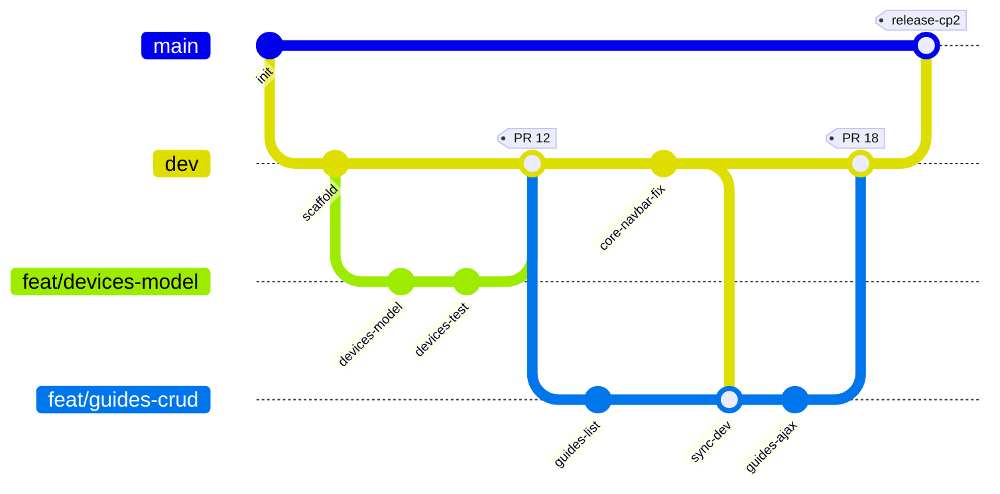
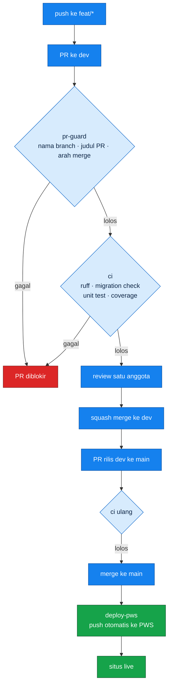

# Contributing to Sparein

Rules below are enforced by CI, by branch protection, or by both. Read once, then work from the cheat sheet at the bottom.

## Branch model

```
main   release only, mirrors what runs on PWS
 └ dev  default branch, integration target for every module
    └ feat/<module>-<slug>
      fix/<module>-<slug>
      chore/<scope>-<slug>
      docs/<scope>-<slug>
      test/<module>-<slug>
```

Nobody pushes to `main`. Nobody pushes to `dev`. Both are protected and reject direct pushes.

`main` accepts a pull request only when the head branch is `dev`. A release is therefore always the whole integrated state, never a single feature.

## Daily loop

```bash
git checkout dev
git pull origin dev

git checkout -b feat/guides-safety-warning
# work, commit, repeat
git push -u origin feat/guides-safety-warning
```

Open the pull request against `dev`. Mark it **Draft** while the feature is incomplete. A ready-for-review PR means the feature works and its tests pass. It is not a place to park unfinished work.

Keep the branch current while you work:

```bash
git fetch origin
git merge origin/dev
```

Merge `dev` into your branch, never the reverse, and never rebase a branch someone else has already pulled.

## Commit messages

Conventional Commits v1.0.0, imperative mood, lowercase, no trailing period, subject at most 72 characters.

```
<type>(<scope>): <description>

[body wrapped at 72]

[footers]
```

Allowed types: `feat`, `fix`, `docs`, `style`, `refactor`, `perf`, `test`, `build`, `ci`, `chore`, `revert`.

Scope is the Django app: `core`, `devices`, `diagnostics`, `guides`, `parts`, `journal`.

```
feat(guides): add safety warning list to guide detail
fix(devices): stop duplicate slug on ifixit reimport
test(parts): cover compatibility filter by device
```

One commit, one type. A change that fits two types is two commits.

The **pull request title** follows the same grammar, because squash merge turns it into the commit that lands on `dev`.

## Pull request rules

| Rule | Enforced by |
|---|---|
| One approval before merge | branch protection |
| CI green before merge | branch protection |
| Squash merge only | repository setting |
| Branch name matches the pattern | `pr-guard` workflow |
| PR title is a valid Conventional Commit | `pr-guard` workflow |
| PR into `main` comes from `dev` | `pr-guard` workflow |
| Changes under `core/` need two approvals | CODEOWNERS |

Review SLA is 24 hours. If a PR sits longer, ping the reviewer in the group chat. Do not merge around them.

Delete nothing after merge: feature branches stay for history tracking, as the course guide asks.

## Module boundaries

Each member owns exactly one Django app. Inside it you are free; outside it you are a consumer.

- Reach other modules through **exported selectors and foreign keys only**. Never query another app's tables directly, never import another app's private helpers.
- Create migrations only inside your own app. Never edit, squash, or delete someone else's migration.
- Anything under `core/` is shared. Touching it means two approvals and a heads-up in the group chat.
- A change that breaks another module's contract needs an Issue labelled `breaking` opened *before* the PR.

The contract each module publishes is listed in [`docs/MODULES.md`](docs/MODULES.md). Update that file in the same PR that changes the contract.

## Before you open a PR

```bash
ruff check .
python manage.py makemigrations --check --dry-run
python manage.py test
coverage run --source='.' manage.py test && coverage report
```

CI runs the same four commands. Running them locally first saves a review cycle.

## Merge conflicts

```bash
git checkout feat/guides-safety-warning
git fetch origin
git merge origin/dev
# resolve in the editor, keep both intents where possible
git add .
git commit
git push
```

Conflicts inside `core/base.html` are the common case. Resolve by keeping both blocks unless the two changes genuinely contradict; if they do, ask the other author before picking a side.

## Git Workflow

`main` tidak pernah disentuh langsung. Semua pekerjaan berangkat dari `dev` dan kembali ke `dev` lewat Pull Request.



| Branch | Role | Protection |
|---|---|---|
| `main` | Rilis. Isinya persis yang berjalan di PWS. | PR wajib, satu approval, CI hijau, admin tidak bisa bypass. Hanya menerima merge dari `dev`. |
| `dev` | Branch default, tempat semua modul terintegrasi. | PR wajib, satu approval, CI hijau. |
| `feat/*`, `fix/*`, `chore/*`, `docs/*`, `test/*` | Satu branch satu pekerjaan, dibuat dari `dev`. | tidak ada |

Aturan yang dijalankan otomatis oleh CI:

- Nama branch mengikuti pola `<type>/<modul>-<slug>`, contoh `feat/guides-safety-warning`.
- Judul PR mengikuti Conventional Commits, contoh `feat(guides): add safety warning list`.
- PR ke `main` hanya diterima kalau sumbernya `dev`.
- Merge memakai **squash merge**, jadi riwayat `dev` tetap satu commit per PR.
- PR yang masih berjalan ditandai **Draft**. PR siap-review berarti fiturnya sudah selesai dan tesnya lulus, bukan sekadar checkpoint harian.

---

## CI/CD



| Workflow | Trigger | Does |
|---|---|---|
| [`pr-guard.yml`](.github/workflows/pr-guard.yml) | PR dibuka atau diperbarui | Validasi nama branch, judul PR, dan arah merge |
| [`ci.yml`](.github/workflows/ci.yml) | PR ke `dev` atau `main`, push ke `dev` | `ruff`, `makemigrations --check`, unit test, laporan coverage, cek kelengkapan README |
| [`deploy-pws.yml`](.github/workflows/deploy-pws.yml) | push ke `main` | Push otomatis ke PWS memakai secret `PWS_URL` |

Kredensial PWS disimpan sebagai repository secret bernama `PWS_URL` dan tidak pernah masuk ke dalam kode.

## Secrets

`PWS_URL` lives only as a GitHub repository secret. Database credentials live only in `.env`, which is gitignored. Nothing that looks like a credential belongs in a commit, a screenshot, or an Issue comment. If one leaks, rotate it first and clean history second.

## Cheat sheet

```bash
git checkout dev && git pull origin dev      # start clean
git checkout -b feat/<module>-<slug>         # branch from dev
git commit -m "feat(<module>): <description>"
git push -u origin feat/<module>-<slug>
# open PR -> base: dev, Draft until done, 1 approval, squash merge
```
