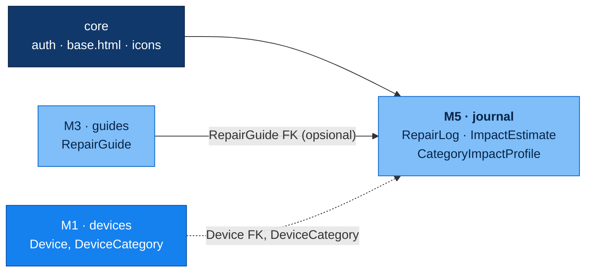
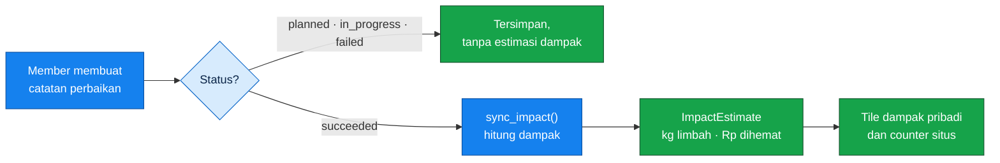
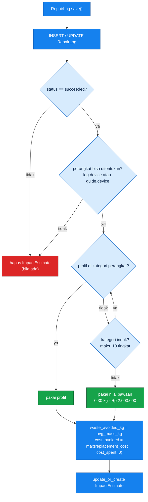
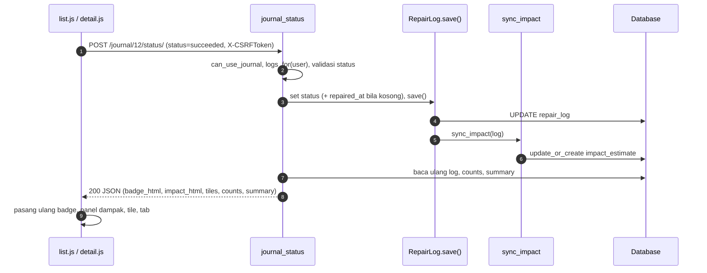
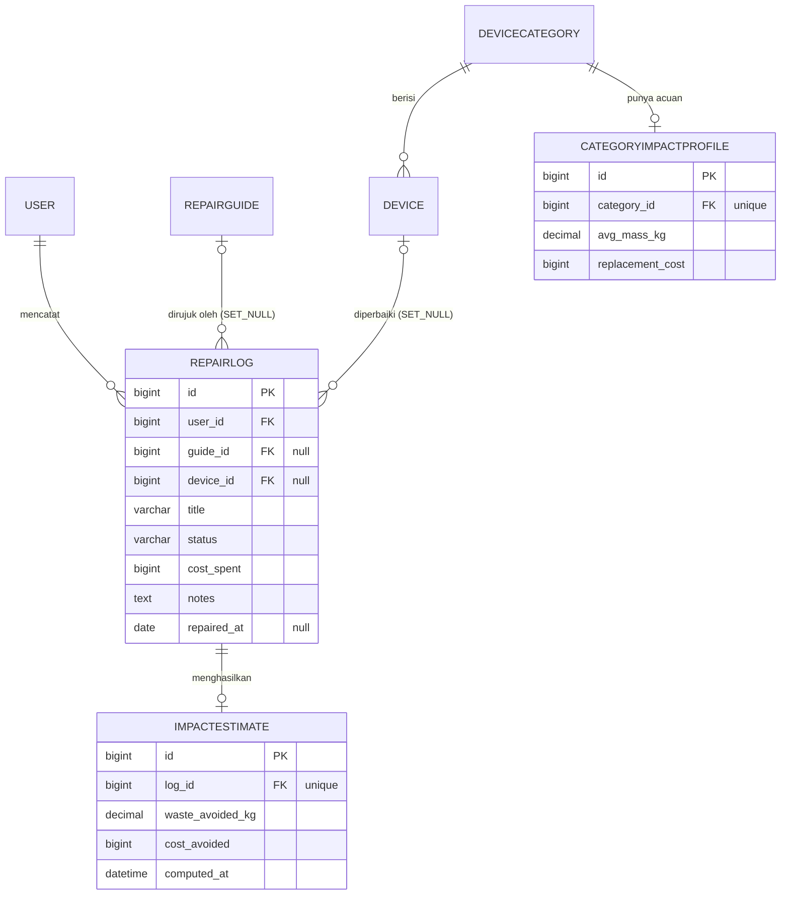

<p align="center">
  <picture>
    <source media="(prefers-color-scheme: dark)" srcset="../docs/brand/sparein-lockup-dark.svg">
    
  </picture>
</p>

<h1 align="center">M5 · Repair Journal &amp; Impact</h1>

<p align="center"><em>Setiap perbaikan yang berhasil adalah satu barang yang tidak jadi sampah.</em></p>

<p align="center">
  
  
  
  
  
</p>

<p align="center">
  <a href="#1-header-modul">Header</a> ·
  <a href="#2-contract-per-method">Contract per Method</a> ·
  <a href="#3-data-contract">Data Contract</a> ·
  <a href="#4-publik-vs-internal">Publik vs Internal</a> ·
  <a href="#5-config">Config</a> ·
  <a href="#6-migration">Migration</a> ·
  <a href="#7-changelog">Changelog</a>
  ·
  <a href="#8-ai-disclosure">AI Disclosure</a>
</p>

---

## 1. Header Modul

| | |
|---|---|
| **Purpose** | Mencatat perbaikan yang direncanakan, dikerjakan, berhasil, atau gagal, lalu menghitung otomatis dampaknya, yaitu **limbah elektronik yang dihindari (kg)** dan **biaya beli baru yang dihemat (Rp)**. |
| **Owner (PIC)** | Marsya Rizka Aulia, NPM 2506586236 |
| **Versi** | `1.0.0` |
| **Django app** | `journal` |
| **Role yang boleh memakai** | Member, Contributor, Admin. Visitor hanya melihat counter dampak seluruh situs. |
| **Posisi di build order** | Lapis 3, konsumen akhir. Tidak ada modul lain yang bergantung padanya. |

### Dependencies



| Dari | Yang dipakai | Dipakai di | Sifat |
|---|---|---|---|
| `core` | `core.permissions.is_member`, `base.html`, ikon `core/icons/*`, URL `login` dan `core:register` | `permissions.py`, template, `views.py` | Wajib |
| `devices` (M1) | `Device`, `DeviceCategory` (FK dan rantai `parent`), `devices.selectors.get_device_qs()` | `models.py`, `impact.py`, `forms.py` | Wajib untuk menghitung dampak |
| `guides` (M3) | `RepairGuide` (FK), `guides.selectors.visible_guides(user)` | `models.py`, `forms.py`, `views.py` | Opsional, catatan tetap valid tanpa panduan |
| `django.contrib.auth` | `settings.AUTH_USER_MODEL` | `models.py` | Wajib |

Sesuai **Module Boundary Rules** di README utama, journal tidak pernah query langsung ke tabel milik modul lain. Semua akses lewat FK dan fungsi selector yang diekspor.

---

## Ringkasan



Fitur utama:

- CRUD catatan perbaikan milik pribadi, dengan tab filter per status dan paginasi 12 item per halaman.
- Ubah status langsung dari kartu lewat AJAX (`fetch`), tanpa pindah halaman.
- Buat catatan dari halaman panduan: `?guide=<slug>` mengisi judul, perangkat, dan status otomatis.
- Estimasi dampak dihitung per kategori perangkat, dengan fallback ke kategori induk dan nilai bawaan.
- Counter dampak seluruh situs untuk Visitor sebagai ajakan bergabung.

<details>
<summary><b>Struktur folder</b></summary>

```text
journal/
├── models.py              RepairLog, ImpactEstimate, CategoryImpactProfile
├── views.py               7 view (6 halaman/AJAX + 1 JSON API)
├── urls.py                routing app (namespace "journal")
├── forms.py               RepairLogForm, StatusFilterForm, widget kartu status
├── impact.py              logika hitung dampak (sync_impact)
├── selectors.py           query baca: logs_for, status_counts, ringkasan dampak
├── permissions.py         can_use_journal
├── formatting.py          rupiah, rupiah_short, kg, short_date
├── templatetags/          filter template untuk formatting
├── management/commands/   seed_impact_profiles
├── migrations/            0001_repairlog, 0002_categoryimpactprofile_impactestimate
├── templates/journal/     list, detail, form, confirm_delete, partial
├── static/journal/        css, js (list, detail, form), ikon svg
├── admin.py               registrasi 3 model
└── tests.py               106 tes, 18 kelas
```

</details>

---

## 2. Contract per Method

### Ringkasan endpoint

Semua route di bawah berada di dalam prefix `/journal/`, kecuali Summary API.

| # | Method | URL | Name | Akses | Respons |
|---|---|---|---|---|---|
| 1 | `GET` | `/journal/` | `journal:list` | Visitor dan Member | HTML (atau fragment HTML untuk AJAX) |
| 2 | `GET` `POST` | `/journal/create/` | `journal:create` | Member | HTML, redirect saat sukses |
| 3 | `GET` | `/journal/<pk>/` | `journal:detail` | Member (pemilik) | HTML |
| 4 | `GET` `POST` | `/journal/<pk>/edit/` | `journal:edit` | Member (pemilik) | HTML, redirect saat sukses |
| 5 | `GET` `POST` | `/journal/<pk>/delete/` | `journal:delete` | Member (pemilik) | HTML, redirect saat sukses |
| 6 | `POST` | `/journal/<pk>/status/` | `journal:status` | Member (pemilik) | **JSON** |
| 7 | `GET` | `/api/journal/summary/` | (project urls) | Member | **JSON** |

### Konvensi yang berlaku di semua method

| Topik | Aturan |
|---|---|
| **Gerbang akses** | Baris pertama setiap view memanggil `can_use_journal(request.user)`, yang meneruskan ke `core.permissions.is_member`. |
| **Respons akses ditolak** | Request yang meminta JSON (`Accept: application/json`) atau membawa `X-Requested-With` mendapat `403 {"error": "Akses ditolak."}`. Request browser biasa dialihkan ke halaman login dengan `?next=`. Pengecualian: `journal_list` tidak menolak Visitor, melainkan menampilkan versi publik. |
| **Kepemilikan** | Semua view per-objek mengambil data lewat `logs_for(request.user)`. Catatan milik orang lain **tidak ditemukan**, hasilnya `404`, bukan `403`, supaya keberadaan data tidak bocor. |
| **CSRF** | Semua `POST` wajib membawa token CSRF. AJAX mengirimnya lewat header `X-CSRFToken`. |
| **HTTP method lain** | Dijaga `@require_http_methods`, hasilnya `405`. |
| **Event dan cache** | Modul **tidak** memancarkan Django signal atau event kustom, dan **tidak** memakai cache. Satu-satunya side effect lintas-objek adalah sinkronisasi `ImpactEstimate` (lihat [Impact calculation](#impact-calculation)). |

### Klasifikasi error

Dipakai di seluruh tabel kontrak di bawah.

| Kode | Penyebab | Retryable? |
|---|---|---|
| `302` | Visitor mengakses halaman Member | **Tidak.** Login dulu, lalu ulangi. |
| `400` | Validasi form gagal, atau nilai `status` tidak dikenal | **Tidak.** Perbaiki input, mengulang payload yang sama pasti gagal lagi. |
| `403` `Akses ditolak.` | Visitor memanggil endpoint JSON | **Tidak** sampai pengguna login. |
| `403` CSRF | Token CSRF hilang atau kedaluwarsa | **Ya, sekali**, setelah memuat ulang halaman untuk mengambil token baru. |
| `404` | Objek tidak ada atau bukan milik pemanggil | **Tidak.** |
| `405` | HTTP method tidak diizinkan | **Tidak.** |
| `500` | Kegagalan sementara di sisi server | **Ya** untuk method idempoten. Untuk `create`, cek dulu apakah catatan sudah terbuat agar tidak dobel. |

---

### 2.1 `journal_list`

`GET /journal/` · name `journal:list`

| Aspek | Kontrak |
|---|---|
| **Signature** | `journal_list(request: HttpRequest) -> HttpResponse`<br/>Query: `status` (opsional, salah satu `planned` `in_progress` `succeeded` `failed`), `page` (opsional, integer)<br/>Header opsional: `X-Requested-With: XMLHttpRequest` |
| **Return** | `200` `journal/list.html` (halaman penuh).<br/>`200` `journal/_list_results.html` (fragment) bila request AJAX.<br/>Konteks Member: `page`, `status`, `counts`, `total`, `tabs`, `tiles`, `statuses`. Konteks Visitor: `visitor=True`, `tiles`. |
| **Deskripsi** | Menampilkan daftar catatan milik pengguna dengan tab status, tile dampak pribadi, dan paginasi. Visitor melihat tile dampak seluruh situs beserta ajakan masuk atau daftar. |
| **Precondition** | Tidak ada. Method ini terbuka untuk Visitor. |
| **Postcondition** | Tidak ada perubahan data. Nilai `status` yang tidak valid diabaikan (diperlakukan sebagai "Semua"). `page` non-angka menghasilkan halaman 1, `page` di luar rentang menghasilkan halaman terakhir. |
| **Errors** | Hanya `405` untuk method selain `GET` (**tidak retryable**). Tidak ada `400`, karena input yang salah diabaikan, bukan ditolak. |
| **Side effects** | Tidak ada. Read-only. |
| **Idempotency & transaction** | Idempoten penuh dan aman di-retry kapan saja. Hanya membaca, tidak ada transaksi tulis. |

### 2.2 `journal_create`

`GET` `POST /journal/create/` · name `journal:create`

| Aspek | Kontrak |
|---|---|
| **Signature** | `journal_create(request: HttpRequest) -> HttpResponse`<br/>Query `GET`: `guide` (opsional, slug `RepairGuide`)<br/>Body `POST`: field `RepairLogForm`, lihat [Form DTO](#form-dto-repairlogform) |
| **Return** | `GET` → `200` form (terisi awal).<br/>`POST` valid → `302` ke `journal:detail`.<br/>`POST` tidak valid → `400` form dirender ulang beserta pesan error. |
| **Deskripsi** | Membuat catatan perbaikan baru. Jika `?guide=<slug>` valid dan terlihat oleh pengguna, form terisi awal: `guide`, `device`, `title` = `"Perbaikan: <judul panduan>"` (dipotong 120 karakter), `status` = `in_progress`. Tanpa panduan, `repaired_at` terisi tanggal hari ini dan status `planned`. |
| **Precondition** | Pengguna Member. Untuk prefill: panduan ada dan lolos `visible_guides(user)` (draf milik orang lain diabaikan). Untuk `POST`: seluruh aturan validasi form terpenuhi. |
| **Postcondition** | Satu baris `RepairLog` baru dengan `user = request.user`, **selalu**, meski payload mencoba mengirim `user`. Jika `status = succeeded` dan perangkat bisa ditentukan, satu baris `ImpactEstimate` ikut terbentuk. |
| **Errors** | `400` validasi form (**tidak retryable**, perbaiki input).<br/>`302` login untuk Visitor, `403` JSON untuk AJAX (**tidak retryable**).<br/>`403` CSRF (**retryable sekali** setelah muat ulang).<br/>Slug panduan tidak valid **bukan error**, prefill dilewati. |
| **Side effects** | `INSERT` `RepairLog`, lalu `sync_impact` (`INSERT` `ImpactEstimate` bila berlaku).<br/>Flash message: `"Catatan tersimpan."`, ditambah `"Kamu baru saja menyelamatkan X kg limbah!"` bila ada estimasi.<br/>Event: tidak ada. Cache: tidak ada. |
| **Idempotency & transaction** | **Tidak idempoten.** Setiap `POST` valid membuat catatan baru, tanpa dedup atau idempotency key, sehingga klik ganda atau retry buta menghasilkan duplikat. Penulisan log dan estimasi adalah dua `INSERT` berurutan di `save()`, tidak dibungkus `transaction.atomic()` eksplisit (lihat [Known limitations](#known-limitations)). |

### 2.3 `journal_detail`

`GET /journal/<pk>/` · name `journal:detail`

| Aspek | Kontrak |
|---|---|
| **Signature** | `journal_detail(request: HttpRequest, pk: int) -> HttpResponse` |
| **Return** | `200` `journal/detail.html`. Konteks: `log`, `device`, `impact` (`ImpactEstimate` atau `None`), `basis` (nama kategori acuan atau `None`). |
| **Deskripsi** | Menampilkan satu catatan lengkap. Bila berstatus Berhasil, tampil panel dampak beserta kategori acuannya. Bila acuan tidak ada, panel menjelaskan bahwa nilai bawaan dipakai. Bila perangkat kosong, tampil pesan bahwa dampak belum bisa dihitung. |
| **Precondition** | Pengguna Member dan pemilik catatan `pk`. |
| **Postcondition** | Tidak ada perubahan data. `device` diambil dari catatan, atau dari `guide.device` bila kosong. |
| **Errors** | `404` bukan milik pemanggil atau tidak ada (**tidak retryable**).<br/>`302` login atau `403` JSON untuk Visitor (**tidak retryable**).<br/>`405` selain `GET`. |
| **Side effects** | Tidak ada. |
| **Idempotency & transaction** | Idempoten penuh. Read-only. |

### 2.4 `journal_edit`

`GET` `POST /journal/<pk>/edit/` · name `journal:edit`

| Aspek | Kontrak |
|---|---|
| **Signature** | `journal_edit(request: HttpRequest, pk: int) -> HttpResponse`<br/>Body `POST`: field `RepairLogForm` |
| **Return** | `GET` → `200` form terisi data catatan.<br/>`POST` valid → `302` ke `journal:detail`.<br/>`POST` tidak valid → `400` form dirender ulang. |
| **Deskripsi** | Mengubah catatan yang sudah ada. Estimasi dampak dihitung ulang mengikuti status, perangkat, dan biaya yang baru. |
| **Precondition** | Pengguna Member dan pemilik catatan. Aturan validasi form terpenuhi. |
| **Postcondition** | `RepairLog` diperbarui dan `user` tetap pemilik semula. `ImpactEstimate` sinkron dengan kondisi terbaru: dibuat atau diperbarui bila `succeeded` dengan perangkat yang bisa ditentukan, dihapus bila tidak. |
| **Errors** | Sama dengan `journal_create`, ditambah `404` bila catatan bukan milik pemanggil (**tidak retryable**). |
| **Side effects** | `UPDATE` `RepairLog`, lalu `sync_impact` (`INSERT`, `UPDATE`, atau `DELETE` `ImpactEstimate`; `computed_at` ikut diperbarui).<br/>Flash message sama seperti `create`.<br/>Event: tidak ada. Cache: tidak ada. |
| **Idempotency & transaction** | **Idempoten secara hasil.** Mengirim payload yang sama berulang menghasilkan state akhir yang sama (hanya `computed_at` yang bergeser). Aman di-retry. Dua tulis berurutan tanpa `atomic()` eksplisit, sama seperti `create`. Concurrent edit bersifat *last write wins*, tanpa locking. |

### 2.5 `journal_delete`

`GET` `POST /journal/<pk>/delete/` · name `journal:delete`

| Aspek | Kontrak |
|---|---|
| **Signature** | `journal_delete(request: HttpRequest, pk: int) -> HttpResponse` |
| **Return** | `GET` → `200` halaman konfirmasi `journal/confirm_delete.html`, **tanpa menghapus apa pun**.<br/>`POST` → `302` ke `journal:list`. |
| **Deskripsi** | Menghapus catatan setelah konfirmasi dua langkah (tampil konfirmasi, baru `POST`). |
| **Precondition** | Pengguna Member dan pemilik catatan. |
| **Postcondition** | `RepairLog` terhapus. `ImpactEstimate` terkait ikut terhapus (`CASCADE`), sehingga total dampak pribadi dan situs langsung turun. |
| **Errors** | `404` bila tidak ada atau bukan milik pemanggil (**tidak retryable**).<br/>`403` CSRF (**retryable sekali**).<br/>`302` login atau `403` JSON untuk Visitor. |
| **Side effects** | `DELETE` `RepairLog` dan `ImpactEstimate` (cascade). Flash message `"Catatan dihapus."`. Event: tidak ada. Cache: tidak ada. |
| **Idempotency & transaction** | **Idempoten pada state akhir, tapi tidak pada respons.** Hasil akhirnya sama (catatan hilang), namun pemanggilan kedua mendapat `404`. Retry setelah timeout boleh, dan `404` pada retry berarti penghapusan pertama sudah berhasil. Cascade dieksekusi Django dalam satu operasi hapus. |

### 2.6 `journal_status`

`POST /journal/<pk>/status/` · name `journal:status`

| Aspek | Kontrak |
|---|---|
| **Signature** | `journal_status(request: HttpRequest, pk: int) -> JsonResponse`<br/>Body (form-encoded): `status` ∈ `planned` `in_progress` `succeeded` `failed`<br/>Header: `X-CSRFToken`, `X-Requested-With: XMLHttpRequest`, `Accept: application/json` |
| **Return** | `200` JSON, lihat [Status response](#json-status-response).<br/>`400` `{"errors": {"status": ["Status tidak valid."]}}`. |
| **Deskripsi** | Mengubah status satu catatan tanpa membuka form, dipakai menu status di kartu dan tombol "Tandai berhasil" di detail. Respons membawa HTML badge dan panel dampak yang sudah dirender, ringkasan terbaru, tile, dan jumlah per status, sehingga UI cukup memasang ulang tanpa menghitung apa pun. |
| **Precondition** | Pengguna Member dan pemilik catatan. `status` adalah salah satu nilai `RepairLog.Status`. |
| **Postcondition** | `status` tersimpan. Bila status baru `succeeded` atau `failed` **dan** `repaired_at` masih kosong, `repaired_at` diisi tanggal hari ini. `ImpactEstimate` disinkronkan. Keluar dari `succeeded` menghapus estimasi. |
| **Errors** | `400` status tidak valid (**tidak retryable**).<br/>`403` JSON untuk Visitor (**tidak retryable**).<br/>`403` CSRF (**retryable sekali** setelah muat ulang).<br/>`404` bukan milik pemanggil (**tidak retryable**).<br/>`405` selain `POST`. |
| **Side effects** | `UPDATE` `RepairLog` (`status`, dan `repaired_at` bila terisi otomatis), lalu `sync_impact`.<br/>Event: tidak ada. Cache: tidak ada. |
| **Idempotency & transaction** | **Idempoten.** Mengirim status yang sama berulang tidak mengubah state (`repaired_at` hanya terisi saat kosong). Aman di-retry. Menulis log lalu estimasi tanpa `atomic()` eksplisit, dan *last write wins* bila dua tab mengubah status bersamaan. |

### 2.7 `journal_summary_api`

`GET /api/journal/summary/`

| Aspek | Kontrak |
|---|---|
| **Signature** | `journal_summary_api(request: HttpRequest) -> JsonResponse` |
| **Return** | `200` JSON, lihat [Summary response](#json-summary-response).<br/>`403` `{"error": "Akses ditolak."}` untuk non-Member. |
| **Deskripsi** | Ringkasan dampak pribadi, total dampak seluruh situs, dan jumlah catatan per status. Disediakan untuk widget atau halaman lain yang butuh angka dampak. |
| **Precondition** | Pengguna Member. |
| **Postcondition** | Tidak ada perubahan data. `by_status` selalu memuat keempat status (bernilai `0` bila kosong). Catatan pengguna lain tidak ikut terhitung di `summary` dan `by_status`. |
| **Errors** | `403` (**tidak retryable** sampai login).<br/>`405` selain `GET`. Method ini selalu membalas JSON, tidak pernah redirect. |
| **Side effects** | Tidak ada. |
| **Idempotency & transaction** | Idempoten penuh. Read-only. |

---

### 2.8 Kontrak domain (internal)

Fungsi di bawah dipanggil oleh view dan model. Bukan bagian antarmuka publik, tapi perilakunya menentukan seluruh hasil hitung dampak.

#### `sync_impact(log)`

| Aspek | Kontrak |
|---|---|
| **Signature** | `sync_impact(log: RepairLog) -> ImpactEstimate \| None` |
| **Deskripsi** | Menyamakan `ImpactEstimate` dengan kondisi terbaru sebuah catatan. Dipanggil otomatis di akhir `RepairLog.save()`, sehingga berlaku untuk form, endpoint status, dan Django admin. |
| **Precondition** | `log` sudah tersimpan (punya `pk`). |
| **Postcondition** | Jika `status == succeeded` **dan** perangkat bisa ditentukan → tepat satu `ImpactEstimate` untuk `log` dengan nilai terbaru, lalu mengembalikannya. Selain itu → tidak ada `ImpactEstimate` untuk `log`, lalu mengembalikan `None`. |
| **Errors** | `IntegrityError` bila dua proses membuat estimasi untuk `log` yang sama bersamaan (**retryable**). |
| **Side effects** | `INSERT` / `UPDATE` / `DELETE` pada `ImpactEstimate`. Event dan cache: tidak ada. |
| **Idempotency & transaction** | **Idempoten.** Memakai `update_or_create` atau `delete`, dan hasilnya deterministik untuk input yang sama. Hanya `computed_at` yang bergeser. Tidak ada transaksi eksplisit. |

#### Fungsi pendukung

| Fungsi | Signature | Perilaku |
|---|---|---|
| `log_device` | `(log) -> Device \| None` | `log.device`, atau `log.guide.device` bila kosong, atau `None`. |
| `find_profile` | `(device) -> CategoryImpactProfile \| None` | Mencari profil di kategori perangkat, lalu naik lewat `parent` (maksimal 10 tingkat, pengaman terhadap rantai melingkar). |
| `profile_values` | `(device) -> tuple[Decimal, int]` | `(avg_mass_kg, replacement_cost)` dari profil, atau `(0.30, 2.000.000)` bila tidak ada profil. |
| `impact_basis` | `(device \| None) -> str \| None` | Nama kategori yang profilnya dipakai, untuk catatan penjelas di UI. `None` bila memakai nilai bawaan. |
| `logs_for` | `(user) -> QuerySet[RepairLog]` | Semua catatan milik `user` (`select_related` guide, device, impact). **Satu-satunya pintu masuk** query per-pengguna. |
| `status_counts` | `(user) -> dict[str, int]` | Jumlah per status ditambah kunci `all`. Semua status selalu hadir. |
| `user_impact_summary` | `(user) -> dict` | `{repairs, waste_avoided_kg, cost_avoided}` milik `user`. |
| `site_impact_totals` | `() -> dict` | Bentuk sama, untuk seluruh pengguna. Bernilai `0` bila belum ada data. |
| `can_use_journal` | `(user) -> bool` | `True` untuk Member ke atas, `False` untuk Visitor. |
| `rupiah` / `rupiah_short` | `(value) -> str` | `Rp 1.250.000` / `Rp 1,3 juta`, otomatis ke `miliar`. |
| `kg` | `(value) -> str` | `0,2 kg`, dua desimal, koma sebagai pemisah, nol di belakang dibuang. |
| `short_date` | `(date) -> str` | `30 Okt 2026`, string kosong bila `None`. |

### Impact calculation



Urutan pencarian profil saat perangkat berada di kategori bertingkat:

```text
Device "iPhone 12"
 └─ Kategori "Apple iPhone"   → tidak punya profil, naik ke induk
     └─ Kategori "Phone"      → punya profil (0.20 kg, Rp 3.000.000)  ✔ dipakai
```

Alur satu perubahan status lewat AJAX:



---

## 3. Data Contract

### Entity relationship



### Entity: `RepairLog`

Catatan aktivitas perbaikan milik pengguna. Urutan bawaan: `-repaired_at`, `-pk`.

| Field | Tipe | Nullable | Default | Constraint |
|---|---|---|---|---|
| `id` | `BigAutoField` | tidak | auto | Primary key |
| `user` | FK → `AUTH_USER_MODEL` | **tidak** | | `on_delete=CASCADE`, `related_name="repair_logs"`. Catatan ikut terhapus bila pengguna dihapus. |
| `guide` | FK → `guides.RepairGuide` | ya | `NULL` | `on_delete=SET_NULL`. Catatan tetap ada bila panduan dihapus. |
| `device` | FK → `devices.Device` | ya | `NULL` | `on_delete=SET_NULL`. Catatan tetap ada bila perangkat dihapus. |
| `title` | `CharField(200)` | tidak | | Form membatasi **120** karakter. |
| `status` | `CharField(12)` | tidak | `planned` | Pilihan: `planned`, `in_progress`, `succeeded`, `failed`. |
| `cost_spent` | `PositiveBigIntegerField` | tidak | `0` | `≥ 0`. Rupiah, bilangan bulat. |
| `notes` | `TextField` | tidak (boleh kosong) | `""` | Form membatasi **2000** karakter. |
| `repaired_at` | `DateField` | ya | `NULL` | Di form **wajib** diisi. |

Nilai `status`:

| Nilai DB | Label tampilan | Menghasilkan estimasi dampak? |
|---|---|---|
| `planned` | Direncanakan | Tidak |
| `in_progress` | Sedang dikerjakan | Tidak |
| `succeeded` | Berhasil | **Ya**, jika perangkat bisa ditentukan |
| `failed` | Gagal | Tidak |

### Entity: `ImpactEstimate`

Hasil hitung dampak, **dibuat dan dihapus otomatis oleh `sync_impact`**. Jangan ditulis manual dari luar modul.

| Field | Tipe | Nullable | Default | Constraint |
|---|---|---|---|---|
| `id` | `BigAutoField` | tidak | auto | Primary key |
| `log` | OneToOne → `RepairLog` | tidak | | `CASCADE`, `related_name="impact"`. Satu catatan paling banyak satu estimasi. |
| `waste_avoided_kg` | `DecimalField(8, 2)` | tidak | | Berat limbah yang dihindari (kg). |
| `cost_avoided` | `PositiveBigIntegerField` | tidak | | `max(replacement_cost − cost_spent, 0)`, tidak pernah negatif. |
| `computed_at` | `DateTimeField` | tidak | `auto_now` | Waktu terakhir estimasi dihitung ulang. |

### Entity: `CategoryImpactProfile`

Data acuan per kategori perangkat. Dikelola lewat seed command dan Django admin.

| Field | Tipe | Nullable | Default | Constraint |
|---|---|---|---|---|
| `id` | `BigAutoField` | tidak | auto | Primary key |
| `category` | OneToOne → `devices.DeviceCategory` | tidak | | `CASCADE`, `related_name="impact_profile"`. Satu kategori satu profil. |
| `avg_mass_kg` | `DecimalField(6, 2)` | tidak | | Rata-rata berat perangkat (kg). |
| `replacement_cost` | `PositiveBigIntegerField` | tidak | | Harga beli baru dalam rupiah. |

### Form DTO: `RepairLogForm`

Kontrak input untuk `journal_create` dan `journal_edit`.

| Field | Widget | Wajib | Constraint | Pesan error |
|---|---|---|---|---|
| `title` | text | ya | maks. 120 karakter | `Judul wajib diisi.` · `Judul maksimal 120 karakter.` |
| `status` | 4 kartu radio | ya | salah satu dari 4 nilai | `Pilih salah satu status.` |
| `guide` | select | tidak | harus ada di `visible_guides(user)` | `Panduan tidak ditemukan.` |
| `device` | select | kondisional | harus ada di `get_device_qs()` | `Perangkat tidak ditemukan.` |
| `repaired_at` | date | ya | format `YYYY-MM-DD` | `Tanggal perbaikan wajib diisi.` · `Format tanggal tidak valid.` |
| `cost_spent` | number | ya | integer `≥ 0` | `Isi biaya, atau 0 kalau gratis.` · `Biaya harus berupa angka.` · `Biaya tidak bisa minus.` |
| `notes` | textarea | tidak | maks. 2000 karakter | `Catatan maksimal 2000 karakter.` |

Aturan lintas-field (`clean()`):

| Aturan | Dikenakan pada | Pesan |
|---|---|---|
| Minimal salah satu dari `guide` atau `device` terisi | `device` | `Isi panduan atau perangkat biar dampaknya bisa dihitung.` |
| Bila keduanya terisi, `guide.device` harus sama dengan `device` | `guide` | `Panduan ini untuk perangkat yang berbeda.` |
| `status = succeeded` tidak boleh bertanggal di masa depan | `repaired_at` | `Tanggal perbaikan yang berhasil tidak bisa di masa depan.` |

`user` **tidak** termasuk field form. Nilainya selalu diisi server dari `request.user`.

`StatusFilterForm` (query `?status=`): satu field `status`, opsional, pilihan `""` (semua) atau salah satu status. Nilai di luar pilihan diabaikan.

### JSON: status response

Respons `200` dari `POST /journal/<pk>/status/`.

```json
{
  "id": 12,
  "status": "succeeded",
  "status_label": "Berhasil",
  "badge_html": "<span class=\"badge-status badge-status--succeeded\">Berhasil</span>",
  "impact_html": "<section class=\"impact-panel\">…</section>",
  "repaired_at": "30 Okt 2026",
  "card_impact": "0,2 kg limbah terhindar",
  "impact": { "waste_avoided_kg": 0.2, "cost_avoided": 2800000 },
  "summary": { "repairs": 1, "waste_avoided_kg": 0.2, "cost_avoided": 2800000 },
  "tiles": { "succeeded": "1", "waste": "0,2 kg", "cost": "Rp 2,8 juta", "total": "3" },
  "counts": { "planned": 1, "in_progress": 1, "succeeded": 1, "failed": 0, "all": 3 },
  "url": "/journal/12/"
}
```

| Field | Tipe | Nullable | Keterangan |
|---|---|---|---|
| `id` | integer | tidak | PK catatan |
| `status` | string | tidak | Nilai DB status |
| `status_label` | string | tidak | Label tampilan (Indonesia) |
| `badge_html` | string | tidak | Fragment HTML siap pasang |
| `impact_html` | string | tidak | Fragment panel dampak siap pasang |
| `repaired_at` | string | tidak | Tanggal ringkas, `""` bila kosong |
| `card_impact` | string | tidak | Teks dampak di kartu, `""` bila tanpa estimasi |
| `impact` | object | **ya** | `null` bila tidak ada estimasi. `waste_avoided_kg` bertipe float, `cost_avoided` integer. |
| `summary` | object | tidak | Total dampak pribadi: `repairs`, `waste_avoided_kg`, `cost_avoided` |
| `tiles` | object | tidak | Nilai tile **yang sudah diformat** (string): `succeeded`, `waste`, `cost`, `total` |
| `counts` | object | tidak | Jumlah per status ditambah `all` |
| `url` | string | tidak | URL halaman detail |

### JSON: summary response

Respons `200` dari `GET /api/journal/summary/`.

```json
{
  "summary":   { "repairs": 4, "waste_avoided_kg": 1.7, "cost_avoided": 12400000 },
  "site":      { "repairs": 38, "waste_avoided_kg": 21.4, "cost_avoided": 96200000 },
  "by_status": { "planned": 2, "in_progress": 1, "succeeded": 4, "failed": 1 }
}
```

`waste_avoided_kg` bertipe float dan `cost_avoided` integer rupiah. Bedakan dengan `tiles` di status response, yang berisi string terformat untuk ditampilkan.

### Format error standar

| Konteks | HTTP | Bentuk |
|---|---|---|
| Validasi form (halaman HTML) | `400` | Form dirender ulang. Error per field di `form.errors`, plus banner yang menyebut jumlah masalah. |
| Validasi JSON | `400` | `{"errors": {"<field>": ["<pesan>", …]}}` |
| Akses ditolak (JSON atau AJAX) | `403` | `{"error": "Akses ditolak."}` |
| Akses ditolak (browser biasa) | `302` | Redirect ke login dengan `?next=<path>` |
| Objek tidak ada atau bukan milik pemanggil | `404` | Halaman 404 bawaan Django |
| Method tidak diizinkan | `405` | Respons bawaan Django |
| CSRF gagal | `403` | Respons CSRF bawaan Django (bukan JSON) |

Semua pesan error ditulis dalam Bahasa Indonesia dan aman ditampilkan langsung ke pengguna. Klien JSON sebaiknya membedakan `errors` (jamak, per field, status `400`) dari `error` (tunggal, string, status `403`).

---

## 4. Publik vs Internal

| | Publik (boleh dipakai pihak lain) | Internal (khusus modul journal) |
|---|---|---|
| **HTTP** | Seluruh route pada [tabel endpoint](#ringkasan-endpoint), termasuk `GET /api/journal/summary/` | Parameter `?guide=` pada `create` adalah kontrak dengan halaman panduan (M3), jangan diubah tanpa Issue `breaking`. |
| **Model** | `RepairLog` dan `ImpactEstimate` hanya sebagai referensi baca (misalnya Django admin) | `CategoryImpactProfile` dikelola lewat seed dan admin |
| **Fungsi** | | `sync_impact`, `find_profile`, `profile_values`, `impact_basis`, `log_device`, seluruh `selectors.py`, `permissions.py`, `formatting.py` |
| **Template dan static** | | `journal/*.html`, `journal/*.css`, `journal/*.js`, `journal/icons/*`, filter `journal_format` |
| **Form** | | `RepairLogForm`, `StatusFilterForm`, `StatusCards`, `GuideSelect` |

Sesuai tabel Module Breakdown di README utama, M5 adalah **konsumen akhir dan tidak mengekspor** selector atau FK ke modul lain. Modul lain **tidak boleh** meng-import `journal.selectors` atau query `RepairLog` langsung. Kebutuhan data dampak dari luar harus lewat `GET /api/journal/summary/`.

---

## 5. Config

### Pemasangan

```python
# settings.py
INSTALLED_APPS = [
    # ...
    "devices",
    "guides",
    "journal",
]

# urls.py (project)
urlpatterns = [
    # ...
    path("journal/", include("journal.urls")),
    path("api/journal/summary/", journal_views.journal_summary_api),
]
```

### Prasyarat settings

| Setting | Kebutuhan |
|---|---|
| `AUTH_USER_MODEL` | Dipakai sebagai target FK `RepairLog.user`. |
| `django.contrib.messages` + middleware | Flash message setelah simpan dan hapus. |
| `CsrfViewMiddleware` | Aktif. Endpoint `status` menolak request tanpa token. |
| `LANGUAGE_CODE = "id"` dan `USE_I18N = True` | `short_date` menampilkan bulan singkatan Indonesia (`Okt`, bukan `Oct`). |
| `STATIC_URL` dan `staticfiles` | Menyajikan `journal/*.css`, `journal/*.js`, dan ikon. |
| URL bernama `login` dan `core:register` | Dipakai tombol di halaman Visitor. |

### Konstanta di kode

Tidak ada environment variable khusus modul ini. Semua nilai bawaan hidup sebagai konstanta.

| Konstanta | Nilai | Lokasi | Fungsi |
|---|---|---|---|
| `PAGE_SIZE` | `12` | `views.py` | Item per halaman di daftar |
| `TITLE_MAX` | `120` | `forms.py` | Batas judul di form |
| `NOTES_MAX` | `2000` | `forms.py` | Batas catatan di form |
| `DEFAULT_MASS_KG` | `0.30` | `impact.py` | Berat bawaan bila tidak ada profil |
| `DEFAULT_REPLACEMENT_COST` | `2_000_000` | `impact.py` | Harga bawaan bila tidak ada profil |
| batas rantai induk | `10` | `impact.py` | Pengaman saat naik ke kategori induk |

### Tuning nilai dampak

Angka profil adalah perkiraan kasar dan **bisa diubah lewat Django admin** (`Category impact profiles`), tanpa deploy ulang. Perubahan hanya berlaku untuk catatan yang disimpan **sesudahnya**. Untuk menghitung ulang semua estimasi lama:

```python
# python manage.py shell
from journal.models import RepairLog
from journal.impact import sync_impact

for log in RepairLog.objects.select_related("device", "guide__device"):
    sync_impact(log)
```

---

## 6. Migration

| Migration | Isi | Depends on |
|---|---|---|
| `0001_repairlog` | Membuat `RepairLog` | `devices.0002_device`, `guides.0002_repairguide_source_author`, `AUTH_USER_MODEL` |
| `0002_categoryimpactprofile_impactestimate` | Membuat `CategoryImpactProfile` dan `ImpactEstimate` | `devices.0002_device`, `journal.0001_repairlog` |

Dibuat dengan Django 5.2.18. Hanya app `journal` yang dimigrasikan oleh PIC M5, sesuai Module Boundary Rules.

```bash
python manage.py migrate journal          # terapkan
python manage.py migrate journal 0001     # mundur: hapus ImpactEstimate dan CategoryImpactProfile
python manage.py migrate journal zero     # mundur total: hapus semua data jurnal
```

> Mundur ke `0001` atau `zero` **menghapus data**. Estimasi dampak bisa dibuat ulang dengan skrip di atas, tapi catatan pengguna yang terhapus tidak bisa dipulihkan.

### Seed data

```bash
python manage.py seed_impact_profiles
```

Jalankan **setelah** `seed_devices`, karena perintah ini membaca `DeviceCategory` yang sudah ada.

| Properti | Perilaku |
|---|---|
| Sasaran | Hanya kategori induk (`parent` kosong) |
| Pencocokan | Kata kunci di nama kategori (tidak peka huruf besar-kecil), kecocokan pertama menang |
| Idempoten | Ya. Memakai `get_or_create`, jadi aman dijalankan ulang dan **tidak menimpa** nilai yang sudah diubah lewat admin |
| Output | `N profil dampak dibuat.` |

| Kata kunci | Berat rata-rata | Harga beli baru |
|---|---|---|
| `laptop` | 1,30 kg | Rp 14.000.000 |
| `tablet` | 0,50 kg | Rp 4.000.000 |
| `console` | 0,40 kg | Rp 4.500.000 |
| `phone` | 0,20 kg | Rp 3.500.000 |

Kategori induk yang tidak cocok dengan kata kunci mana pun tidak mendapat profil dan memakai nilai bawaan (0,30 kg, Rp 2.000.000).

### Testing

```bash
python manage.py test journal
```

106 tes dalam 18 kelas, mencakup: perhitungan dampak, selector, formatting, seed command, akses Visitor dan Member, validasi form, isolasi data antar pengguna, paginasi, filter, AJAX, CSRF, dan Summary API.

### Known limitations

| # | Hal | Dampak | Catatan |
|---|---|---|---|
| 1 | `RepairLog.save()` menulis log lalu estimasi tanpa `transaction.atomic()` eksplisit | Bila gagal di antara dua tulis dan `ATOMIC_REQUESTS` tidak aktif, log bisa tersimpan tanpa estimasi | Pulih sendiri pada penyimpanan berikutnya, atau lewat skrip hitung ulang |
| 2 | Aturan "tanggal berhasil tidak boleh di masa depan" hanya ada di form | Endpoint `status` tidak menjalankannya, dan memakai `date.today()` untuk mengisi `repaired_at` | Berpengaruh hanya bila `repaired_at` sudah diisi tanggal masa depan sebelumnya |
| 3 | `title` berbatas 200 di DB, tetapi 120 di form | Data yang masuk lewat admin bisa lebih panjang dari 120 | Konsisten bila semua input lewat form |
| 4 | `ImpactEstimate` adalah snapshot saat disimpan | Mengubah profil di admin tidak mengubah estimasi lama otomatis | Gunakan skrip hitung ulang |
| 5 | Dua bentuk error JSON (`error` dan `errors`) | Klien perlu menangani keduanya | Lihat [Format error standar](#format-error-standar) |
| 6 | `QuerySet.update()` dan `bulk_create()` melewati `save()` | Estimasi tidak ikut tersinkron | Selalu simpan lewat `save()` |

---

## 7. Changelog

Mengikuti [Semantic Versioning](https://semver.org/lang/id/).

### 1.0.0 · 2026-10-29

- Form catatan final: kartu status, validasi lintas-field, pesan error berbahasa Indonesia, prefill dari panduan (`?guide=`).
- Suite tes lengkap: 106 tes, 18 kelas.
- Dokumentasi modul (README ini).

### 0.3.0 · 2026-10-28

- View dan route CRUD, endpoint AJAX `status`, dan `GET /api/journal/summary/`.
- Daftar dengan tab status, paginasi 12 item, dan fragment hasil untuk AJAX.
- Halaman detail dengan panel dampak dan penjelasan kategori acuan.
- `selectors.py`, `permissions.py`, `formatting.py`, dan template filter `journal_format`.
- Halaman Visitor dengan counter dampak seluruh situs.

### 0.2.0 · 2026-10-26

- Registrasi admin untuk `RepairLog`, `ImpactEstimate`, `CategoryImpactProfile`.
- Management command `seed_impact_profiles`.

### 0.1.0 · 2026-10-23

- Model `RepairLog`, `CategoryImpactProfile`, `ImpactEstimate` beserta migration `0001` dan `0002`.
- Perhitungan dampak awal lewat `sync_impact`.

---

## 8. AI Disclosure

AI digunakan selama proses pengembangan untuk mendukung riset teknis, pemecahan masalah, dan penyusunan dokumentasi. Bantuan AI terutama dimanfaatkan untuk memahami keterkaitan antarmodul, menjaga konsistensi dengan konvensi proyek yang disepakati bersama, mengeksplorasi alternatif pendekatan implementasi, serta menyempurnakan cakupan pengujian dalam lingkungan kerja kolaboratif. Setiap saran yang dihasilkan AI ditinjau, disesuaikan, dan divalidasi kembali berdasarkan kebutuhan proyek. Keputusan arsitektur, implementasi, integrasi, serta tanggung jawab akhir atas modul ini tetap berada pada pengembang yang bersangkutan.

---

<p align="center"><sub>M5 Repair Journal &amp; Impact · Marsya Rizka Aulia · Kelompok 1 · Pemrograman Berbasis Platform · Fakultas Ilmu Komputer, Universitas Indonesia · Gasal 2026/2027</sub></p>