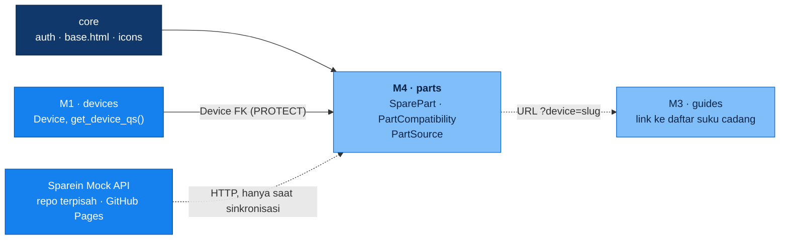
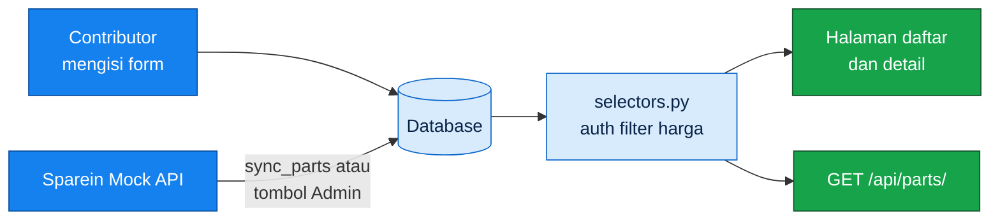
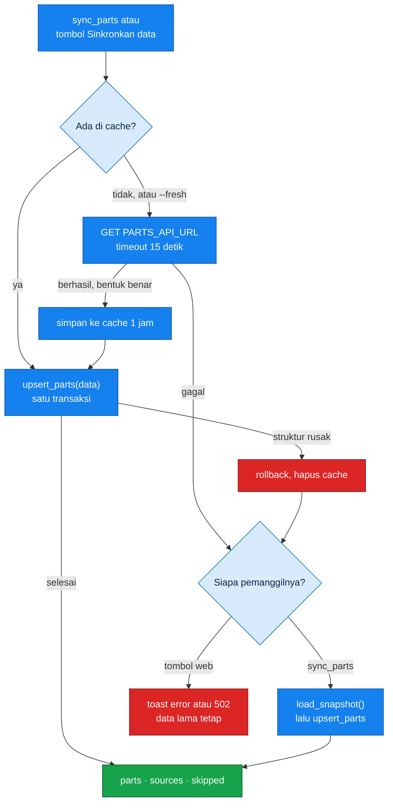
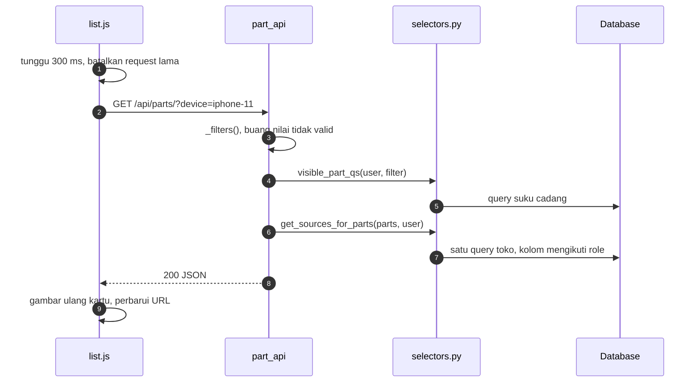
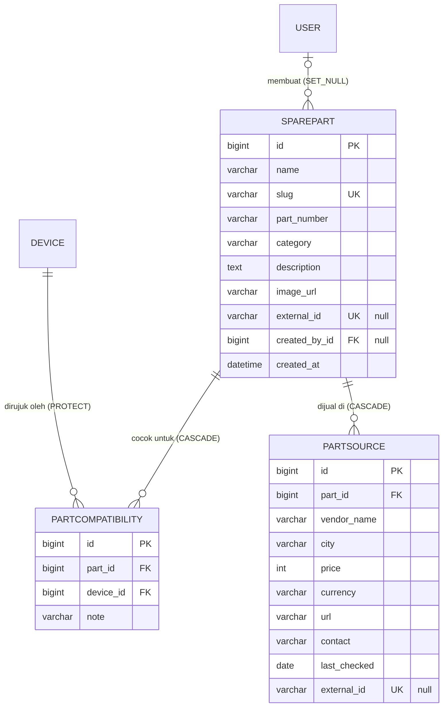

<p align="center">
  <picture>
    <source media="(prefers-color-scheme: dark)" srcset="../brand/sparein-lockup-dark.svg">
    
  </picture>
</p>

<h1 align="center">M4 · Spare Part Directory</h1>

<p align="center"><em>Cek suku cadang yang cocok dan toko yang menjualnya. Sparein tidak menjual barang.</em></p>

<p align="center">
  
  
  
  
  
</p>

<p align="center">
  <a href="#1-header-modul">Header</a> ·
  <a href="#2-contract-per-method">Contract per Method</a> ·
  <a href="#3-data-contract">Data Contract</a> ·
  <a href="#4-publik-vs-internal">Publik vs Internal</a> ·
  <a href="#5-config">Config</a> ·
  <a href="#6-migration">Migration</a> ·
  <a href="#7-changelog">Changelog</a>
</p>

---

## 1. Header Modul

| | |
|---|---|
| **Purpose** | Menunjukkan suku cadang yang cocok untuk sebuah perangkat dan toko yang menjualnya. Data berasal dari input Contributor dan sinkronisasi Mock API, lalu keduanya disimpan di database. Modul ini hanya berisi informasi dan rujukan, tanpa keranjang, checkout, atau pembayaran. |
| **Owner (PIC)** | Muhamad Ayrazhan, NPM 2506586236, Kelompok 1 |
| **Versi** | `1.0.0` |
| **Django app** | `parts` |
| **Role yang boleh memakai** | Semua role. Visitor melihat katalog tanpa harga dan kontak. Member melihat harga dan kontak. Contributor mendaftarkan suku cadang dan mengedit miliknya. Admin mengedit semua data, menghapus, dan menjalankan sinkronisasi. |
| **Posisi di build order** | Lapis 2, paralel dengan M2 dan M3. Bergantung pada `core` dan M1. |

### Dependencies



| Dari | Yang dipakai | Dipakai di | Sifat |
|---|---|---|---|
| `core` | `core.permissions.is_member`, `is_contributor`, `is_admin`, `base.html`, `partials/alert.html`, `partials/empty_state.html`, ikon `core/icons/*`, URL `login` dan `core:register` | `selectors.py`, `views.py`, template | Wajib |
| `devices` (M1) | `Device` (FK), `devices.selectors.get_device_qs()`, URL `devices:detail` | `models.py`, `forms.py`, `views.py`, `mock_api.py`, `part_detail.html` | Wajib |
| Sparein Mock API | `GET /v1/parts.json` | `mock_api.py` | Hanya untuk sinkronisasi. Halaman tetap berjalan saat API mati. |
| `requests` | `requests.get` | `mock_api.py` | Wajib untuk sinkronisasi |
| `django.contrib.auth` | `settings.AUTH_USER_MODEL` | `models.py` | Wajib |

Modul yang bergantung pada M4:

| Modul | Yang dipakai | Dipakai di | Sifat |
|---|---|---|---|
| `devices` (M1) | `PartCompatibility.device` memakai `PROTECT`, jadi perangkat yang masih punya suku cadang tidak bisa dihapus | `devices/views.py` menangkap `ProtectedError` | Wajib |
| `guides` (M3) | Link `/parts/?device=<slug>` dari halaman panduan | `guides/templates/guides/detail.html` | Opsional |

Sesuai **Module Boundary Rules** di [README utama](../../README.md), parts tidak pernah query langsung ke tabel milik modul lain. Semua akses lewat FK dan fungsi selector yang diekspor.

---

## Ringkasan



Halaman tidak pernah memanggil Mock API. API hanya dibaca saat sinkronisasi, jadi situs tetap berjalan saat API mati.

Fitur utama:

- Daftar suku cadang dengan pencarian nama atau nomor part, filter perangkat, kategori, dan harga maksimal.
- Filter langsung tanpa memuat ulang halaman lewat `fetch` ke `GET /api/parts/`. Tanpa JavaScript, form tetap bekerja lewat tombol **Terapkan filter**.
- Halaman detail berisi perangkat yang cocok, tabel toko, penanda data lama, dan tombol salin nomor part.
- Satu form untuk suku cadang, maksimal 20 perangkat, dan maksimal 30 toko, disimpan dalam satu transaksi.
- Sinkronisasi dari Mock API lewat command `sync_parts` dan tombol **Sinkronkan data** khusus Admin.
- Auth filter di level queryset. Visitor tidak pernah menerima `price`, `currency`, dan `contact`, baik di HTML maupun JSON.

<details>
<summary><b>Struktur folder</b></summary>

```text
parts/
├── models.py              SparePart, PartCompatibility, PartSource, unique_slug
├── views.py               7 view (5 halaman + 1 JSON API + 1 sync)
├── urls.py                routing app (namespace "parts")
├── forms.py               SparePartForm, CompatibilityFormSet, SourceForm, SourceFormSet
├── selectors.py           query baca dan auth filter harga
├── mock_api.py            fetch_parts, load_snapshot, upsert_parts, ApiSourceForm
├── data/                  parts_snapshot.json, salinan lokal Mock API
├── management/commands/   sync_parts
├── migrations/            0001_initial
├── templates/parts/       list, detail, form, confirm_delete, partial
├── templatetags/          filter rupiah dan days_ago
├── static/parts/          css, js (list, detail, form), ikon svg
├── admin.py               registrasi SparePart beserta inline
└── tests.py               94 tes, 17 kelas
```

</details>

---

## 2. Contract per Method

### Ringkasan endpoint

Semua route dipasang tanpa prefix lewat `path("", include("parts.urls"))`.

| # | Method | URL | Name | Akses | Respons |
|---|---|---|---|---|---|
| 1 | `GET` | `/parts/` | `parts:list` | Semua role | HTML |
| 2 | `GET` | `/parts/<slug>/` | `parts:detail` | Semua role | HTML |
| 3 | `GET` `POST` | `/parts/create/` | `parts:create` | Contributor | HTML, redirect saat sukses, atau **JSON** untuk `POST` |
| 4 | `GET` `POST` | `/parts/<slug>/edit/` | `parts:edit` | Contributor pemilik, Admin | HTML, redirect saat sukses, atau **JSON** untuk `POST` |
| 5 | `GET` `POST` | `/parts/<slug>/delete/` | `parts:delete` | Admin | HTML, redirect saat sukses, atau **JSON** untuk `POST` |
| 6 | `GET` | `/api/parts/` | `parts:api` | Semua role | **JSON** |
| 7 | `POST` | `/parts/sync/` | `parts:sync` | Admin | Redirect, atau **JSON** |

### Konvensi yang berlaku di semua method

| Topik | Aturan |
|---|---|
| **Gerbang akses** | Akses ditentukan `core.permissions`. `is_member` berlaku untuk semua yang login, `is_contributor` untuk Contributor dan Admin, `is_admin` untuk Admin dan superuser. |
| **Kepemilikan** | `_can_edit` mengizinkan Admin, atau Contributor yang tercatat di `created_by`. Hasil sync punya `created_by = NULL`, jadi hanya Admin yang bisa mengeditnya. Menghapus hanya untuk Admin, termasuk untuk suku cadang milik Contributor. |
| **Urutan pemeriksaan** | `edit` dan `delete` mengambil objek dulu, baru memeriksa izin. Slug yang tidak ada selalu menghasilkan `404`, juga untuk Visitor. |
| **Respons akses ditolak** | Lewat `_deny`. Request JSON dari Visitor mendapat `401`, dan dari pengguna login mendapat `403`, keduanya `{"error": "Akses ditolak."}`. Browser Visitor dialihkan ke login dengan `?next=`, dan browser pengguna login mendapat halaman `403.html`. |
| **Deteksi JSON** | `wants_json` hanya melihat header `Accept` yang memuat `application/json`. `X-Requested-With` tidak dipakai. |
| **Auth filter** | `price`, `currency`, dan `contact` tidak ikut di-select untuk Visitor. `max_price` dibuang untuk Visitor karena filter harga bisa dipakai menebak harga. Toko untuk Visitor diurutkan berdasarkan nama, bukan harga. |
| **CSRF** | Semua `POST` wajib membawa token CSRF. Kegagalan CSRF dibalas halaman HTML Django, juga untuk klien JSON. |
| **HTTP method lain** | `create`, `edit`, `delete`, `api`, dan `sync` dijaga `@require_http_methods`, hasilnya `405`. `part_list` dan `part_detail` tidak dijaga (lihat [Known limitations](#known-limitations)). |
| **Event dan cache** | Modul **tidak** memancarkan Django signal atau event kustom. Cache hanya dipakai `fetch_parts`, dengan key `parts-mock-api` selama 1 jam. |

### Klasifikasi error

Dipakai di seluruh tabel kontrak di bawah.

| Kode | Penyebab | Retryable? |
|---|---|---|
| `302` ke login | Visitor mengakses halaman yang butuh login | **Tidak.** Login dulu, lalu ulangi. |
| `400` | Validasi form gagal | **Tidak.** Perbaiki input, mengulang payload yang sama pasti gagal lagi. |
| `401` `Akses ditolak.` | Visitor memanggil endpoint tulis dengan `Accept: application/json` | **Tidak** sampai pengguna login. |
| `403` | Role kurang atau bukan pemilik | **Tidak.** |
| `403` CSRF | Token CSRF hilang atau kedaluwarsa | **Ya, sekali**, setelah memuat ulang halaman untuk mengambil token baru. |
| `404` | Slug tidak ada | **Tidak.** |
| `405` | HTTP method tidak diizinkan | **Tidak.** |
| `502` `Mock API tidak dapat diakses.` | Jaringan gagal, timeout, status HTTP gagal, atau body bukan JSON | **Ya**, setelah jeda. |
| `502` `Respons Mock API tidak valid.` atau `Format data Mock API tidak sesuai.` | Struktur data Mock API salah | **Tidak** sampai datanya diperbaiki. Data rusak tidak tertinggal di cache, jadi perbaikan langsung terbaca. |
| `500` (DB lock, koneksi putus, `IntegrityError` saat dua request menulis `slug` atau `external_id` yang sama) | Kegagalan sementara di sisi server | **Ya** untuk method idempoten. Untuk `create`, cek dulu apakah suku cadangnya sudah terbuat agar tidak dobel. |

---

### 2.1 `part_list`

`GET /parts/` · name `parts:list`

| Aspek | Kontrak |
|---|---|
| **Signature** | `part_list(request: HttpRequest) -> HttpResponse`<br/>Query: `q`, `device`, `category`, `max_price`, semuanya opsional. Lihat [Filter query](#filter-query). |
| **Return** | `200` `parts/part_list.html`.<br/>Konteks: `parts`, `devices`, `categories`, `filters`, `show_price`, `quick_prices`, `empty_message`, `show_reset`, `can_create`, `can_sync`. |
| **Deskripsi** | Menampilkan maksimal 60 suku cadang beserta filternya. Member melihat harga terendah di tiap kartu. Dropdown perangkat hanya memuat perangkat yang sudah punya suku cadang, ditambah perangkat yang sedang dipilih. Tombol tambah muncul untuk Contributor dan tombol sinkronisasi untuk Admin. |
| **Precondition** | Tidak ada. Method ini terbuka untuk Visitor. |
| **Postcondition** | Tidak ada perubahan data. Nilai filter yang tidak valid dibuang, bukan ditolak. `max_price` selalu diabaikan untuk Visitor. |
| **Errors** | Tidak ada error dari input. Slug perangkat yang tidak dikenal menghasilkan daftar kosong dengan status `200`. |
| **Side effects** | Tidak ada. Read-only. |
| **Idempotency & transaction** | Idempoten penuh dan aman di-retry kapan saja. Hanya membaca, tidak ada transaksi tulis. |

### 2.2 `part_detail`

`GET /parts/<slug>/` · name `parts:detail`

| Aspek | Kontrak |
|---|---|
| **Signature** | `part_detail(request: HttpRequest, slug: str) -> HttpResponse` |
| **Return** | `200` `parts/part_detail.html`.<br/>Konteks: `part`, `compatibilities`, `sources`, `show_price`, `lowest_price`, `highest_price`, `can_edit`, `can_delete`. |
| **Deskripsi** | Menampilkan satu suku cadang, perangkat yang cocok, dan tabel toko. Toko dengan `last_checked` lebih tua dari 30 hari mendapat `stale = True` dan penanda data lama. |
| **Precondition** | Suku cadang dengan `slug` tersebut ada. |
| **Postcondition** | Tidak ada perubahan data. Untuk Visitor, `sources` tidak memuat `price`, `currency`, dan `contact`, lalu diurutkan berdasarkan `vendor_name`. Untuk Member, urutannya `price` lalu `vendor_name`. `lowest_price` dan `highest_price` bernilai `None` untuk Visitor atau bila tidak ada toko. |
| **Errors** | `404` slug tidak ada (**tidak retryable**). |
| **Side effects** | Tidak ada. Read-only. |
| **Idempotency & transaction** | Idempoten penuh. Hanya membaca. |

### 2.3 `part_create`

`GET` `POST /parts/create/` · name `parts:create`

| Aspek | Kontrak |
|---|---|
| **Signature** | `part_create(request: HttpRequest) -> HttpResponse`<br/>Body `POST` (form-encoded): field `SparePartForm`, formset prefix `compat`, dan formset prefix `sources`. Lihat [Form DTO](#form-dto-sparepartform).<br/>Header opsional: `Accept: application/json` |
| **Return** | `GET` → `200` `parts/part_form.html`.<br/>`POST` valid → `302` ke `parts:detail`, atau `201` [`{id, slug, url}`](#json-respons-tulis) untuk JSON.<br/>`POST` tidak valid → `400` form dirender ulang, atau `400` [`{"errors": …}`](#format-error-standar) untuk JSON. |
| **Deskripsi** | Membuat satu suku cadang beserta perangkat yang cocok dan tokonya dari satu form. |
| **Precondition** | Pengguna Contributor atau Admin. Minimal 1 perangkat, maksimal 20 perangkat, maksimal 30 toko, dan seluruh aturan validasi terpenuhi. |
| **Postcondition** | Satu `SparePart` baru dengan `created_by = request.user`, `external_id = NULL`, dan `slug` unik. `PartCompatibility` dan `PartSource` terbentuk sesuai baris form. Semua toko baru mendapat `last_checked` hari ini. |
| **Errors** | `400` validasi (**tidak retryable**, perbaiki input).<br/>`302` login untuk Visitor, `401` JSON untuk Visitor, `403` untuk Member (**tidak retryable**).<br/>`403` CSRF (**retryable sekali** setelah muat ulang).<br/>`405` method lain. |
| **Side effects** | `INSERT` `SparePart`, `PartCompatibility`, dan `PartSource`.<br/>Flash message `"Suku cadang tersimpan."` untuk respons HTML.<br/>Event: tidak ada. Cache: tidak ada. |
| **Idempotency & transaction** | **Tidak idempoten.** Setiap `POST` valid membuat suku cadang baru dengan slug berakhiran `-2`, `-3`, dan seterusnya, tanpa dedup atau idempotency key. Semua tulis berada dalam satu `transaction.atomic()`. |

### 2.4 `part_edit`

`GET` `POST /parts/<slug>/edit/` · name `parts:edit`

| Aspek | Kontrak |
|---|---|
| **Signature** | `part_edit(request: HttpRequest, slug: str) -> HttpResponse`<br/>Body `POST`: sama dengan `part_create`. Baris toko lama wajib membawa `sources-N-id`. |
| **Return** | `GET` → `200` form terisi data lama.<br/>`POST` valid → `302` ke `parts:detail`, atau `200` `{id, slug, url}` untuk JSON.<br/>`POST` tidak valid → `400`, sama seperti `part_create`. |
| **Deskripsi** | Mengubah suku cadang, daftar perangkat, dan daftar tokonya. |
| **Precondition** | Suku cadang ada. Pengguna Admin, atau Contributor yang tercatat di `created_by`. Aturan validasi terpenuhi. |
| **Postcondition** | Field suku cadang diperbarui. `slug`, `created_by`, dan `external_id` tidak berubah, jadi mengganti nama tidak memutus link lama. Semua `PartCompatibility` dihapus lalu dibuat ulang dari form. Toko yang berubah mendapat `last_checked` hari ini, dan toko yang dicentang hapus terhapus. |
| **Errors** | Sama dengan `part_create`, ditambah `404` slug tidak ada dan `403` bukan pemilik (**tidak retryable**). |
| **Side effects** | `UPDATE` `SparePart`, `DELETE` dan `INSERT` `PartCompatibility`, serta `INSERT`, `UPDATE`, atau `DELETE` `PartSource`.<br/>Flash message `"Suku cadang tersimpan."` untuk respons HTML.<br/>Event: tidak ada. Cache: tidak ada. |
| **Idempotency & transaction** | **Idempoten untuk suku cadang, perangkat, dan toko lama.** Baris toko baru (tanpa `id`) dibuat lagi setiap payload dikirim ulang, jadi retry buta bisa menggandakan toko baru. Semua tulis berada dalam satu `transaction.atomic()`. Concurrent edit bersifat *last write wins*, tanpa locking. Editan pada baris hasil sync ditimpa sync berikutnya. |

### 2.5 `part_delete`

`GET` `POST /parts/<slug>/delete/` · name `parts:delete`

| Aspek | Kontrak |
|---|---|
| **Signature** | `part_delete(request: HttpRequest, slug: str) -> HttpResponse` |
| **Return** | `GET` → `200` halaman konfirmasi `parts/part_confirm_delete.html`, **tanpa menghapus apa pun**.<br/>`POST` → `302` ke `parts:list`, atau `200` `{"deleted": true}` untuk JSON. |
| **Deskripsi** | Menghapus suku cadang setelah konfirmasi dua langkah. |
| **Precondition** | Suku cadang ada. Pengguna Admin. |
| **Postcondition** | `SparePart` terhapus, begitu juga `PartCompatibility` dan `PartSource` miliknya (`CASCADE`). Suku cadang hasil sync **dibuat lagi** pada sync berikutnya selama masih ada di Mock API. |
| **Errors** | `404` slug tidak ada (**tidak retryable**).<br/>`302` login atau `401` JSON untuk Visitor, `403` untuk selain Admin (**tidak retryable**).<br/>`403` CSRF (**retryable sekali**). |
| **Side effects** | `DELETE` tiga tabel lewat cascade. Flash message `"Suku cadang dihapus."` untuk respons HTML. Event: tidak ada. Cache: tidak ada. |
| **Idempotency & transaction** | **Idempoten pada state akhir, tapi tidak pada respons.** Pemanggilan kedua mendapat `404`, yang berarti penghapusan pertama sudah berhasil. Cascade dieksekusi Django dalam satu operasi hapus. |

### 2.6 `part_api`

`GET /api/parts/` · name `parts:api`

| Aspek | Kontrak |
|---|---|
| **Signature** | `part_api(request: HttpRequest) -> JsonResponse`<br/>Query: sama dengan `part_list`, lihat [Filter query](#filter-query). |
| **Return** | `200` JSON, lihat [daftar suku cadang](#json-daftar-suku-cadang). |
| **Deskripsi** | Data direktori untuk filter AJAX di `list.js`, sekaligus antarmuka publik modul untuk pihak lain. Toko diambil dalam satu query, jadi tidak ada N+1. |
| **Precondition** | Tidak ada. Method ini terbuka untuk Visitor. |
| **Postcondition** | Tidak ada perubahan data. Untuk Visitor, kunci `lowest_price`, `highest_price`, `price`, `currency`, dan `contact` **tidak ada sama sekali**, bukan `null`. Untuk Member, `lowest_price` dan `highest_price` bernilai `null` bila tidak ada toko. |
| **Errors** | `405` selain `GET`, termasuk `HEAD` (**tidak retryable**). Tidak ada `400`, karena input yang salah dibuang. |
| **Side effects** | Tidak ada. Read-only, dan responsnya tidak di-cache. |
| **Idempotency & transaction** | Idempoten penuh. Hanya membaca. |

### 2.7 `part_sync`

`POST /parts/sync/` · name `parts:sync`

| Aspek | Kontrak |
|---|---|
| **Signature** | `part_sync(request: HttpRequest) -> HttpResponse`<br/>Tanpa body. Header opsional: `Accept: application/json` |
| **Return** | Sukses → `302` ke `parts:list` dengan toast, atau `200` [`{parts, sources, skipped}`](#json-respons-tulis) untuk JSON.<br/>Gagal → `302` ke `parts:list` dengan toast error, atau `502` `{"error": "<pesan>"}` untuk JSON. |
| **Deskripsi** | Tombol **Sinkronkan data** khusus Admin di `/parts/`. Ada karena PWS tidak menyediakan shell untuk menjalankan `sync_parts`. Berbeda dari command, view ini **tidak** memakai snapshot saat gagal. |
| **Precondition** | Pengguna Admin dan token CSRF valid. |
| **Postcondition** | Sukses: sama dengan [`upsert_parts`](#upsert_partsdata). Gagal: database tidak berubah. |
| **Errors** | `302` login atau `401` JSON untuk Visitor, `403` untuk selain Admin (**tidak retryable**).<br/>`403` CSRF (**retryable sekali**).<br/>`405` selain `POST`.<br/>Kegagalan Mock API: lihat `502` di [Klasifikasi error](#klasifikasi-error). |
| **Side effects** | Panggilan HTTP keluar bila cache kosong. `INSERT` dan `UPDATE` pada tiga tabel. `cache.set`, dan `cache.delete` bila struktur data rusak.<br/>Flash message `"Sinkronisasi selesai: X suku cadang, Y toko, Z dilewati."` atau pesan gagal.<br/>Event: tidak ada. |
| **Idempotency & transaction** | **Idempoten** untuk isi Mock API yang sama. Seluruh penulisan berada dalam satu transaksi di `upsert_parts`. |

### 2.8 `sync_parts`

`python manage.py sync_parts [--fresh]`

| Aspek | Kontrak |
|---|---|
| **Signature** | `Command.handle(*args, fresh: bool, **opts) -> None`<br/>Opsi `--fresh`: melewati pembacaan cache. |
| **Return** | stdout `Synced X parts, Y sources, Z skipped`, exit code `0`.<br/>Saat fallback, stderr menampilkan `Mock API unavailable (<pesan>), loading snapshot`, lalu stdout tetap seperti di atas. |
| **Deskripsi** | Mengisi database dari Mock API. Bila gagal, memakai `parts/data/parts_snapshot.json`, jadi setup lokal tetap berjalan tanpa internet. |
| **Precondition** | Migration sudah dijalankan. Data perangkat sudah ada, karena slug yang tidak dikenal dilewati. |
| **Postcondition** | Sama dengan [`upsert_parts`](#upsert_partsdata), dari Mock API atau snapshot. |
| **Errors** | `SyncFailure` dari Mock API ditangkap dan memicu fallback.<br/>Kegagalan membaca atau memproses snapshot **tidak** ditangkap, sehingga command berhenti dengan traceback (**tidak retryable** sampai snapshot diperbaiki). |
| **Side effects** | Sama dengan `part_sync`, tanpa flash message. |
| **Idempotency & transaction** | **Idempoten.** Aman dijalankan berulang, termasuk setelah fallback. Baris dicocokkan lewat `external_id`, jadi tidak ada data ganda. |

> Dengan cache bawaan (`LocMemCache`), setiap proses command mulai dari cache kosong, jadi `sync_parts` selalu mengambil data baru dan `--fresh` tidak mengubah hasilnya. Opsi ini baru berpengaruh bila `CACHES` memakai backend bersama seperti Redis.

---

### 2.9 Kontrak domain

`get_part_qs` dan `get_part_or_404` adalah kontrak yang diekspor ke modul lain, sesuai [`docs/MODULES.md`](../MODULES.md). Sisanya internal, tapi menentukan seluruh perilaku filter dan sinkronisasi.

#### `get_part_qs(...)`

| Aspek | Kontrak |
|---|---|
| **Signature** | `get_part_qs(*, q: str = None, device: str = None, category: str \| list[str] = None, max_price: int = None) -> QuerySet[SparePart]` |
| **Deskripsi** | Queryset suku cadang dengan filter opsional. Filter kosong dilewati. `device` memakai slug perangkat. |
| **Precondition** | Tidak ada. Semua parameter keyword-only. |
| **Postcondition** | Mengembalikan queryset tanpa duplikat, berurutan `name`. Filter `max_price` cocok bila minimal satu toko berharga `≤ max_price`. |
| **Errors** | Tidak ada. Input yang tidak cocok menghasilkan queryset kosong. |
| **Side effects** | Tidak ada. |
| **Idempotency & transaction** | Idempoten. Hanya membaca. |

Hasil `get_part_qs` **belum** melewati auth filter. Jangan menampilkan `part.sources` dari hasilnya kepada Visitor.

#### `get_part_or_404(slug)`

| Aspek | Kontrak |
|---|---|
| **Signature** | `get_part_or_404(slug: str) -> SparePart` |
| **Deskripsi** | Mengambil satu suku cadang berdasarkan slug. |
| **Precondition** | Tidak ada. |
| **Postcondition** | Mengembalikan `SparePart`. |
| **Errors** | `Http404` bila slug tidak ada (**tidak retryable**). |
| **Side effects** | Tidak ada. |
| **Idempotency & transaction** | Idempoten. Hanya membaca. |

#### `fetch_parts(*, fresh=False)`

| Aspek | Kontrak |
|---|---|
| **Signature** | `fetch_parts(*, fresh: bool = False) -> dict` |
| **Deskripsi** | Mengambil JSON Mock API dari `settings.PARTS_API_URL`, dengan cache 1 jam. |
| **Precondition** | `PARTS_API_URL` terisi. |
| **Postcondition** | Mengembalikan `dict` yang memuat list `parts`, dan menyimpannya ke cache. `fresh=True` melewati pembacaan cache, tapi hasilnya tetap disimpan. |
| **Errors** | `SyncFailure("Mock API tidak dapat diakses. …")` untuk `requests.RequestException` atau JSON rusak (**retryable** setelah jeda).<br/>`SyncFailure("Respons Mock API tidak valid. …")` bila bentuknya bukan `dict` berisi list `parts` (**tidak retryable** sampai datanya diperbaiki). |
| **Side effects** | `GET` keluar dengan timeout 15 detik bila cache kosong. `cache.set` saat berhasil. Respons yang gagal tidak disimpan. |
| **Idempotency & transaction** | Idempoten terhadap database karena tidak menulis ke sana. |

#### `upsert_parts(data)`

| Aspek | Kontrak |
|---|---|
| **Signature** | `upsert_parts(data: dict) -> dict[str, int]` |
| **Deskripsi** | Menyimpan isi Mock API ke database, dengan pencocokan lewat `external_id`. Validasinya memakai `SparePartForm` dan `ApiSourceForm`, jadi aturannya sama dengan input manual. |
| **Precondition** | `data` berisi list `parts`, dan tiap baris memuat `id`, `compatible_devices`, dan `sources`. Lihat [Feed Mock API](#feed-mock-api). |
| **Postcondition** | Baris valid dibuat atau diperbarui. Hasil sync baru punya `created_by = NULL`. `slug` hanya diisi saat baris pertama kali dibuat. Mengembalikan `{"parts": n, "sources": n, "skipped": n}`. Baris tanpa `external_id` tidak disentuh, dan tidak ada baris yang dihapus. |
| **Errors** | `SyncFailure("Format data Mock API tidak sesuai.")` untuk `KeyError`, `TypeError`, atau `AttributeError` (**tidak retryable** sampai datanya diperbaiki).<br/>`IntegrityError` saat dua sync berjalan bersamaan tidak ditangkap (**retryable**, karena transaksi sudah dibatalkan). |
| **Side effects** | `INSERT` dan `UPDATE` pada `SparePart`, `PartCompatibility`, dan `PartSource`. `cache.delete` saat struktur rusak, supaya data rusak tidak tertinggal di cache. |
| **Idempotency & transaction** | **Idempoten.** Dibungkus `@transaction.atomic`. Struktur rusak membatalkan seluruh sync, termasuk baris yang sudah tersimpan sebelumnya. |

`skipped` menjumlahkan suku cadang yang ditolak, toko yang ditolak, dan slug perangkat yang tidak dikenal. Perangkat dan toko dari suku cadang yang ditolak tidak ikut dihitung.

#### Fungsi pendukung

| Fungsi | Signature | Perilaku |
|---|---|---|
| `visible_part_qs` | `(user, **filters) -> QuerySet` | `get_part_qs` plus anotasi `source_count`. Member juga mendapat `lowest_price` dan `highest_price`. `max_price` dibuang untuk Visitor. |
| `get_sources_for` | `(part, user) -> QuerySet[dict]` | Toko satu suku cadang, kolomnya mengikuti role. |
| `get_sources_for_parts` | `(parts, user) -> dict[int, list[dict]]` | Sama, untuk banyak suku cadang dalam satu query. |
| `load_snapshot` | `() -> dict` | Membaca `parts/data/parts_snapshot.json`. |
| `unique_slug` | `(value) -> str` | Slug dari nama, maksimal 200 karakter, ditambah akhiran bila bentrok. Slug `create` dan `sync` dihindari. Nama tanpa huruf atau angka menjadi `suku-cadang`. |
| `_can_edit` | `(user, part) -> bool` | Admin, atau Contributor pemilik. |
| `_filters` | `(request, *, with_price) -> dict` | Membaca filter dari query string dan membuang nilai yang tidak valid. |
| `_price` | `(value) -> int \| None` | Nilai positif, dibatasi `MAX_PRICE`. Selain itu `None`. |
| `rupiah` | filter template | `185000` menjadi `Rp 185.000`, string kosong bila `None`. |
| `days_ago` | filter template | Tanggal menjadi `hari ini`, `kemarin`, atau `12 hari lalu`. |

### Alur sinkronisasi



Alur satu perubahan filter lewat AJAX:



---

## 3. Data Contract

### Entity relationship



### Entity: `SparePart`

Satu jenis suku cadang. Urutan bawaan: `name`.

| Field | Tipe | Nullable | Default | Constraint |
|---|---|---|---|---|
| `id` | `BigAutoField` | tidak | auto | Primary key |
| `name` | `CharField(200)` | tidak | | |
| `slug` | `SlugField(210)` | tidak | dari `name` | Unique. Diisi `unique_slug` saat pertama disimpan dan tidak berubah saat nama diganti. |
| `part_number` | `CharField(100)` | tidak (boleh kosong) | `""` | |
| `category` | `CharField(20)` | tidak | | Salah satu dari 6 nilai di bawah. |
| `description` | `TextField` | tidak (boleh kosong) | `""` | |
| `image_url` | `URLField(200)` | tidak (boleh kosong) | `""` | |
| `external_id` | `CharField(50)` | **ya** | `NULL` | Unique. Id dari Mock API, `NULL` untuk input manual. |
| `created_by` | FK → `AUTH_USER_MODEL` | ya | `NULL` | `on_delete=SET_NULL`. Menentukan pemilik. `NULL` untuk hasil sync. |
| `created_at` | `DateTimeField` | tidak | `auto_now_add` | |

Nilai `category`:

| Nilai DB | Label tampilan |
|---|---|
| `battery` | Baterai |
| `screen` | Layar |
| `charger` | Charger |
| `cable` | Kabel |
| `motor` | Motor |
| `other` | Lainnya |

### Entity: `PartCompatibility`

Penghubung suku cadang dan perangkat yang cocok.

| Field | Tipe | Nullable | Default | Constraint |
|---|---|---|---|---|
| `id` | `BigAutoField` | tidak | auto | Primary key |
| `part` | FK → `SparePart` | tidak | | `CASCADE`, `related_name="compatibilities"` |
| `device` | FK → `devices.Device` | tidak | | `PROTECT`, `related_name="part_compatibilities"`. Perangkat yang masih dirujuk tidak bisa dihapus. |
| `note` | `CharField(200)` | tidak (boleh kosong) | `""` | Contoh: `Bukan untuk Pro`. |

`UniqueConstraint("part", "device")` bernama `unique_part_device`: satu perangkat hanya sekali per suku cadang.

### Entity: `PartSource`

Satu toko yang menjual suku cadang. Urutan bawaan: `vendor_name`.

| Field | Tipe | Nullable | Default | Constraint |
|---|---|---|---|---|
| `id` | `BigAutoField` | tidak | auto | Primary key |
| `part` | FK → `SparePart` | tidak | | `CASCADE`, `related_name="sources"` |
| `vendor_name` | `CharField(100)` | tidak | | |
| `city` | `CharField(100)` | tidak | | |
| `price` | `PositiveIntegerField` | tidak | | `≥ 1`, rupiah bilangan bulat. **Hanya untuk Member.** |
| `currency` | `CharField(3)` | tidak | `IDR` | **Hanya untuk Member.** |
| `url` | `URLField(200)` | tidak | | Form mewajibkan `https://`. |
| `contact` | `CharField(100)` | tidak (boleh kosong) | `""` | **Hanya untuk Member.** |
| `last_checked` | `DateField` | tidak | `timezone.localdate` | Lebih tua dari 30 hari berarti data lama. |
| `external_id` | `CharField(50)` | **ya** | `NULL` | Unique. Id dari Mock API, `NULL` untuk input manual. |

### Form DTO: `SparePartForm`

Kontrak input untuk `part_create` dan `part_edit`. Data dikirim form-encoded bersama dua formset di bawah. `slug`, `external_id`, `created_by`, dan `last_checked` **tidak** termasuk input dan selalu diisi server.

| Field | Widget | Wajib | Constraint | Pesan error |
|---|---|---|---|---|
| `name` | text | ya | maks. 200 karakter | Bawaan Django |
| `part_number` | text | tidak | maks. 100 karakter | Bawaan Django |
| `category` | select | ya | salah satu dari 6 nilai | Bawaan Django |
| `description` | textarea | tidak | | |
| `image_url` | url | tidak | URL valid, maks. 200 karakter. Tanpa skema dianggap `https://`. | `Masukkan URL yang valid.` |

### Form DTO: `CompatibilityFormSet`

Prefix `compat`, minimal 1 baris, maksimal 20 baris.

| Field | Widget | Wajib | Constraint | Pesan error |
|---|---|---|---|---|
| `compat-N-device` | select | ya | harus ada di `get_device_qs()`, tidak boleh sama dengan baris lain | `Pilih perangkatnya.` · `Perangkat ini sudah ada di daftar.` |
| `compat-N-note` | text | tidak | maks. 200 karakter | Bawaan Django |
| `compat-N-DELETE` | checkbox | tidak | menghapus baris | |

Error tingkat formset: `Pilih minimal satu perangkat.` · `Maksimal 20 perangkat.`

### Form DTO: `SourceFormSet`

Prefix `sources`, boleh kosong, maksimal 30 baris.

| Field | Widget | Wajib | Constraint | Pesan error |
|---|---|---|---|---|
| `sources-N-id` | hidden | untuk baris lama | PK `PartSource` | |
| `sources-N-vendor_name` | text | ya | maks. 100 karakter | Bawaan Django |
| `sources-N-city` | text | ya | maks. 100 karakter | Bawaan Django |
| `sources-N-price` | number | ya | integer `1` sampai `1.000.000.000` | `Harga minimal Rp 1.` |
| `sources-N-url` | url | ya | wajib `https://`, maks. 200 karakter | `Link toko harus pakai https://.` |
| `sources-N-contact` | text | tidak | maks. 100 karakter | Bawaan Django |
| `sources-N-DELETE` | checkbox | tidak | menghapus baris | |

Kedua formset juga membutuhkan management form bawaan Django, yaitu `<prefix>-TOTAL_FORMS` dan `<prefix>-INITIAL_FORMS`. Tanpa keduanya, responsnya `400` dengan kode `missing_management_form`.

`ApiSourceForm` adalah `SourceForm` untuk sinkronisasi, ditambah `currency` (wajib, maks. 3 karakter) dan `last_checked` (wajib, `YYYY-MM-DD`).

### Filter query

Dipakai `GET /parts/` dan `GET /api/parts/`. Nilai yang tidak valid dibuang, tidak pernah menghasilkan error.

| Parameter | Tipe | Perilaku |
|---|---|---|
| `q` | string | Dipangkas, lalu dicari di `name` atau `part_number`, tidak peka huruf besar-kecil. |
| `device` | slug perangkat | Slug yang tidak dikenal menghasilkan daftar kosong. |
| `category` | string, boleh berulang | Nilai di luar 6 kategori dibuang. Bila semuanya dibuang, filter tidak berlaku. |
| `max_price` | integer | Hanya untuk Member. Non-angka, `0`, dan nilai negatif dibuang. Nilai di atas `1.000.000.000` dibatasi ke angka itu. |

### JSON: daftar suku cadang

Respons `200` dari `GET /api/parts/?device=iphone-11` untuk Member.

```json
{
  "results": [
    {
      "id": 1,
      "name": "Baterai iPhone 11",
      "slug": "baterai-iphone-11",
      "part_number": "BAT-IP11",
      "category": "battery",
      "category_label": "Baterai",
      "image_url": "",
      "url": "/parts/baterai-iphone-11/",
      "source_count": 1,
      "lowest_price": 185000,
      "highest_price": 185000,
      "sources": [
        {
          "vendor_name": "Sinar Ponsel",
          "city": "Depok",
          "url": "https://www.tokopedia.com/search?st=product&q=baterai+iphone+11",
          "last_checked": "2026-10-27",
          "price": 185000,
          "currency": "IDR",
          "contact": "0812-0000-0001"
        }
      ]
    }
  ],
  "limit": 60
}
```

Respons untuk Visitor sama, tetapi tanpa kunci `lowest_price`, `highest_price`, `price`, `currency`, dan `contact`.

| Field | Tipe | Nullable | Keterangan |
|---|---|---|---|
| `results` | array | tidak | Maksimal 60 item, urutannya belum terjamin (lihat [Known limitations](#known-limitations)) |
| `limit` | integer | tidak | Selalu `60` |
| `id` | integer | tidak | PK suku cadang |
| `name`, `slug`, `category` | string | tidak | Nilai dari `SparePart` |
| `category_label` | string | tidak | Label tampilan (Indonesia) |
| `part_number`, `image_url` | string | tidak | `""` bila kosong |
| `url` | string | tidak | URL halaman detail |
| `source_count` | integer | tidak | Jumlah toko |
| `lowest_price`, `highest_price` | integer | **ya** | Hanya Member. `null` bila tidak ada toko. |
| `sources` | array | tidak | `[]` bila tidak ada toko. Member diurutkan berdasarkan harga, Visitor berdasarkan nama toko. |
| `sources[].vendor_name`, `city`, `url` | string | tidak | Nilai dari `PartSource` |
| `sources[].last_checked` | string | tidak | Format `YYYY-MM-DD` |
| `sources[].price` | integer | tidak | Hanya Member |
| `sources[].currency`, `contact` | string | tidak | Hanya Member. `contact` bernilai `""` bila kosong. |

### JSON: respons tulis

| Endpoint | HTTP | Bentuk |
|---|---|---|
| `POST /parts/create/` | `201` | `{"id": 3, "slug": "baterai-baru", "url": "/parts/baterai-baru/"}` |
| `POST /parts/<slug>/edit/` | `200` | Sama dengan `create` |
| `POST /parts/<slug>/delete/` | `200` | `{"deleted": true}` |
| `POST /parts/sync/` | `200` | `{"parts": 26, "sources": 47, "skipped": 0}` |

### Feed Mock API

Skema lengkap, contoh respons, dan cara mengubah data ada di [`docs/MOCK-API.md`](../MOCK-API.md). Tabel berikut mencatat perlakuan `upsert_parts` terhadap tiap kondisi.

| Kondisi | Hasil |
|---|---|
| `parts` bukan list, atau kunci `id`, `compatible_devices`, `sources`, atau `slug` hilang | Seluruh sync dibatalkan dengan `SyncFailure` |
| `note` bukan string | Seluruh sync dibatalkan dengan `SyncFailure` |
| `id` kosong atau lebih dari 50 karakter | Baris dilewati dan dihitung di `skipped` |
| Suku cadang gagal validasi, misalnya `name` kosong atau `category` tidak dikenal | Suku cadang dilewati beserta perangkat dan tokonya, dihitung 1 |
| Toko gagal validasi, misalnya link `http://`, harga `0`, atau tanpa `currency` dan `last_checked` | Toko dilewati dan dihitung 1, suku cadangnya tetap tersimpan |
| Slug perangkat tidak dikenal | Perangkat dilewati dan dihitung 1, suku cadangnya tetap tersimpan |
| `part_number`, `description`, `image_url`, atau `contact` tidak ada | Diterima sebagai string kosong |
| `note` lebih dari 200 karakter | Dipotong menjadi 200 karakter |

### Format error standar

| Konteks | HTTP | Bentuk |
|---|---|---|
| Validasi form (halaman HTML) | `400` | Form dirender ulang dengan error per field dan banner `Ada isian yang belum benar. Cek lagi yang ditandai merah.` |
| Validasi JSON | `400` | Objek `errors`, lihat contoh di bawah |
| Akses ditolak (JSON, Visitor) | `401` | `{"error": "Akses ditolak."}` |
| Akses ditolak (JSON, sudah login) | `403` | `{"error": "Akses ditolak."}` |
| Akses ditolak (browser, Visitor) | `302` | Redirect ke login dengan `?next=<path>` |
| Akses ditolak (browser, sudah login) | `403` | Halaman `403.html` |
| Slug tidak ada | `404` | Halaman `404.html` |
| Method tidak diizinkan | `405` | Respons bawaan Django |
| CSRF gagal | `403` | Respons CSRF bawaan Django (HTML, bukan JSON) |
| Sinkronisasi gagal (JSON) | `502` | `{"error": "<pesan>"}` |
| Sinkronisasi gagal (browser) | `302` | Redirect ke `parts:list` dengan toast error |

Contoh `400` JSON dari `POST /parts/create/`:

```json
{
  "errors": {
    "part": {
      "name": [{ "message": "Bidang ini tidak boleh kosong.", "code": "required" }]
    },
    "compat": [
      { "device": [{ "message": "Pilih perangkatnya.", "code": "required" }] }
    ],
    "compat_errors": [],
    "sources": [
      {
        "price": [{ "message": "Harga minimal Rp 1.", "code": "min_value" }],
        "url": [{ "message": "Link toko harus pakai https://.", "code": "https" }]
      }
    ],
    "source_errors": []
  }
}
```

| Kunci | Bentuk | Isi |
|---|---|---|
| `part` | object | Error `SparePartForm` per field |
| `compat` | array | Satu object per baris perangkat, `{}` bila baris itu valid |
| `compat_errors` | array | Error tingkat formset, misalnya `Pilih minimal satu perangkat.` |
| `sources` | array | Satu object per baris toko, `{}` bila baris itu valid |
| `source_errors` | array | Error tingkat formset toko |

Semua pesan error ditulis dalam Bahasa Indonesia dan aman ditampilkan langsung ke pengguna. Klien JSON sebaiknya membedakan `errors` (object, status `400`) dari `error` (string, status `401`, `403`, atau `502`).

---

## 4. Publik vs Internal

| | Publik (boleh dipakai pihak lain) | Internal (khusus modul parts) |
|---|---|---|
| **HTTP** | Seluruh route pada [tabel endpoint](#ringkasan-endpoint). `GET /api/parts/?device=` dan `/parts/?device=` adalah kontrak antarmodul. | |
| **Fungsi** | `get_part_qs`, `get_part_or_404` | `visible_part_qs`, `get_sources_for`, `get_sources_for_parts`, seluruh `mock_api.py`, dan helper di `views.py` |
| **Model** | Perilaku `PROTECT` pada `PartCompatibility.device`, yang ditangani M1 saat menghapus perangkat | `SparePart`, `PartCompatibility`, dan `PartSource`. Modul lain membaca lewat selector, bukan query langsung. |
| **Command** | `sync_parts` | |
| **Template dan static** | | `parts/*.html`, `parts/*.css`, `parts/*.js`, `parts/icons/*`, filter `parts_tags` |
| **Form** | | `SparePartForm`, `CompatibilityFormSet`, `SourceForm`, `SourceFormSet`, `ApiSourceForm` |

Kebutuhan harga dan toko dari luar modul harus lewat `GET /api/parts/`, karena di sanalah auth filter berlaku. Perubahan yang memutus kontrak di kolom Publik diumumkan lewat Issue berlabel `breaking` sebelum PR dibuka, dan [`docs/MODULES.md`](../MODULES.md) diperbarui di PR yang sama.

---

## 5. Config

### Pemasangan

```python
# settings.py
INSTALLED_APPS = [
    # ...
    "core",
    "devices",
    "parts",
]

# urls.py (project)
urlpatterns = [
    # ...
    path("", include("parts.urls")),
]
```

### Prasyarat settings

| Setting | Kebutuhan |
|---|---|
| `AUTH_USER_MODEL` | Target FK `SparePart.created_by`. |
| `django.contrib.messages` + middleware | Toast setelah simpan, hapus, dan sinkronisasi. |
| `CsrfViewMiddleware` | Aktif. Semua `POST` wajib membawa token. |
| `LANGUAGE_CODE = "id"` | Pesan validasi bawaan Django tampil dalam Bahasa Indonesia. |
| `TIME_ZONE = "Asia/Jakarta"` | Dipakai `timezone.localdate()` untuk `last_checked` dan penanda data lama. |
| `CACHES` | Tanpa konfigurasi khusus, Django memakai `LocMemCache` per proses. |
| `STATIC_URL` dan `staticfiles` | Menyajikan `parts/*.css`, `parts/*.js`, dan ikon. |
| URL `login`, `core:register`, `devices:detail` | Dipakai template. |

### Environment variable

| Variabel | Default | Fungsi |
|---|---|---|
| `PARTS_API_URL` | `https://kelompok1-pbp.github.io/sparein-mock-api/v1/parts.json` | Alamat Mock API. Bila ditulis kosong di `.env`, nilainya string kosong dan default tidak dipakai, sehingga sinkronisasi gagal. |

### Konstanta di kode

| Konstanta | Nilai | Lokasi | Fungsi |
|---|---|---|---|
| `LIMIT` | `60` | `views.py` | Batas hasil di daftar dan API |
| `STALE_DAYS` | `30` | `views.py` | Umur data sebelum diberi penanda data lama |
| `QUICK_PRICES` | `50.000`, `100.000`, `250.000`, `500.000` | `views.py` | Tombol pilihan cepat harga maksimal |
| `MAX_PRICE` | `1_000_000_000` | `forms.py` | Batas harga di form dan filter |
| `RESERVED_SLUGS` | `create`, `sync` | `models.py` | Slug yang bentrok dengan route |
| `PUBLIC_SOURCE_FIELDS` | `vendor_name`, `city`, `url`, `last_checked` | `selectors.py` | Kolom toko untuk Visitor |
| `MEMBER_SOURCE_FIELDS` | kolom publik + `price`, `currency`, `contact` | `selectors.py` | Kolom toko untuk Member |
| `CACHE_KEY` | `parts-mock-api` | `mock_api.py` | Key cache respons API |
| `CACHE_SECONDS` | `3600` | `mock_api.py` | Masa berlaku cache |
| `SNAPSHOT` | `parts/data/parts_snapshot.json` | `mock_api.py` | Salinan lokal Mock API |
| timeout `requests.get` | `15` detik | `mock_api.py` | Batas tunggu Mock API |
| `max_num` formset | `20` perangkat, `30` toko | `forms.py` | Batas baris di form |

---

## 6. Migration

| Migration | Isi | Depends on |
|---|---|---|
| `0001_initial` | Membuat `SparePart`, `PartSource`, dan `PartCompatibility` | `devices.0002_device`, `AUTH_USER_MODEL` |

Dibuat dengan Django 5.2.18. Hanya app `parts` yang dimigrasikan oleh PIC M4, sesuai Module Boundary Rules.

```bash
python manage.py migrate parts        # terapkan
python manage.py migrate parts zero   # mundur total: hapus semua data suku cadang
```

> Mundur ke `zero` **menghapus data**. Hasil sync bisa dibuat ulang dengan `sync_parts`, tapi data yang diisi manual tidak bisa dipulihkan.

### Seed data

Modul ini tidak punya fixture. Data awal berasal dari sinkronisasi.

```bash
python manage.py sync_parts
```

Jalankan **setelah** `seed_devices` atau `loaddata seed_devices`, karena perangkat dicari lewat slug.

| Properti | Perilaku |
|---|---|
| Sumber | Mock API, atau `parts/data/parts_snapshot.json` bila API gagal |
| Isi saat ini | 26 suku cadang dan 47 toko fiktif |
| Pencocokan | `external_id` untuk suku cadang dan toko, pasangan `part` dan `device` untuk kecocokan |
| Idempoten | Ya, aman dijalankan ulang |
| Output | `Synced 26 parts, 47 sources, 0 skipped` |

`SnapshotTests` menjamin semua baris snapshot diterima tanpa ada yang dilewati, diuji terhadap fixture `seed_devices`.

Di PWS tidak ada shell, jadi data diisi dengan menekan tombol **Sinkronkan data** sebagai Admin setelah deploy.

### Testing

```bash
python manage.py test parts
```

94 tes dalam 17 kelas, mencakup: model dan slug, selector, auth filter harga dan kontak, proteksi hapus perangkat, filter template, halaman daftar dan detail, tambah, edit, hapus, JSON API, serta sinkronisasi (cache, upsert, rollback, fallback snapshot, tombol Admin). Tes sinkronisasi memakai mock `requests.get`, jadi tidak membutuhkan internet.

### Known limitations

| # | Hal | Dampak | Catatan |
|---|---|---|---|
| 1 | `visible_part_qs` tidak punya `ORDER BY`, karena `Meta.ordering` tidak berlaku pada query dengan `GROUP BY` | Urutan `/parts/` dan `/api/parts/` tidak terjamin, dan 60 baris yang tampil bisa berubah | Perbaikan: tambahkan `.order_by("name")` di `visible_part_qs` |
| 2 | Batas 60 baris tanpa pagination | Hitungan di halaman berhenti di 60, dan API tidak mengirim total | `limit` di respons menandai batas ini |
| 3 | `part_list` dan `part_detail` tanpa `@require_http_methods` | `POST` dengan token CSRF merender halaman seperti `GET`, bukan `405` | Tidak mengubah data |
| 4 | Cache `LocMemCache` terpisah per proses | Tombol web bisa memakai respons lama sampai 1 jam, dan `sync_parts --fresh` tidak bisa mengosongkan cache proses server | Perubahan Mock API paling lambat terbaca tombol web setelah 1 jam |
| 5 | Baris hasil sync ditimpa setiap sync | Editan manual pada baris itu hilang, dan baris yang dihapus muncul lagi | Ubah datanya di Mock API, bukan di situs |
| 6 | Sync tidak menghapus apa pun | Toko dan kecocokan yang hilang dari Mock API tetap ada. Toko akhirnya bertanda data lama, tapi kecocokan tidak punya penanda. | Hapus manual lewat form atau Django admin |
| 7 | Fallback snapshot hanya ada di `sync_parts` | Tombol web menampilkan error saat API mati | Data lama tetap tampil |
| 8 | `currency` disimpan tapi tidak dipakai | Semua harga tampil sebagai `Rp`, dan harga terendah tidak membedakan mata uang | Mock API hanya berisi `IDR` |
| 9 | `id: null` di Mock API menjadi `external_id` bernilai `"None"` | Baris seperti itu saling menimpa, bukan dilewati | Mock API selalu mengisi `id` |
| 10 | Batas 20 perangkat dan 30 toko hanya ada di form | Sinkronisasi bisa melewati batas ini, dan form edit akan menolaknya sampai baris dikurangi | Belum terjadi pada data sekarang |
| 11 | Snapshot disalin manual dari repo Mock API | Snapshot bisa tertinggal dari data terbaru | Lihat langkahnya di [`docs/MOCK-API.md`](../MOCK-API.md) |
| 12 | Sesi Admin habis saat menekan tombol sync | Setelah login, `?next=/parts/sync/` membuka `GET` dan menghasilkan `405` | Kembali ke `/parts/` lalu tekan ulang |
| 13 | Dua bentuk error JSON (`error` dan `errors`), ditambah CSRF yang berbentuk HTML | Klien perlu menangani ketiganya | Lihat [Format error standar](#format-error-standar) |

---

## 7. Changelog

Mengikuti [Semantic Versioning](https://semver.org/lang/id/). Tanggal diambil dari riwayat git.

### 1.0.0 · 2026-10-30

- Sinkronisasi dari Sparein Mock API: `parts/mock_api.py`, command `sync_parts`, dan tombol `POST /parts/sync/` khusus Admin (#42).
- Fallback ke `parts/data/parts_snapshot.json` saat API gagal.
- Setting `PARTS_API_URL` dan dokumen [`docs/MOCK-API.md`](../MOCK-API.md).
- Form mendapat breadcrumb dan tombol hapus berbentuk ikon dari integrasi desain (#41).
- Dokumentasi modul (dokumen ini).

### 0.4.0 · 2026-10-29

- `GET /api/parts/` dengan auth filter yang sama seperti halaman (#34).
- Filter langsung tanpa memuat ulang lewat `list.js`.
- `get_sources_for_parts` untuk mengambil toko tanpa N+1.

### 0.3.0 · 2026-10-28

- `part_create`, `part_edit`, dan `part_delete`, dengan respons HTML dan JSON (#33).
- `SparePartForm`, `CompatibilityFormSet`, `SourceFormSet`, dan `form.js`.
- `RESERVED_SLUGS` supaya slug tidak bentrok dengan route.

### 0.2.0 · 2026-10-28

- Halaman daftar dan detail, filter perangkat, kategori, pencarian, dan harga maksimal (#32).
- Filter template `rupiah` dan `days_ago`, penanda data lama, dan salin nomor part.

### 0.1.0 · 2026-10-26

- Model `SparePart`, `PartCompatibility`, dan `PartSource` beserta migration `0001_initial` (#30).
- `selectors.py` dengan auth filter harga dan kontak.
- Registrasi Django admin.

---

<p align="center"><sub>M4 Spare Part Directory · Muhamad Ayrazhan · Kelompok 1 · Pemrograman Berbasis Platform · Fakultas Ilmu Komputer, Universitas Indonesia · Gasal 2026/2027</sub></p>
